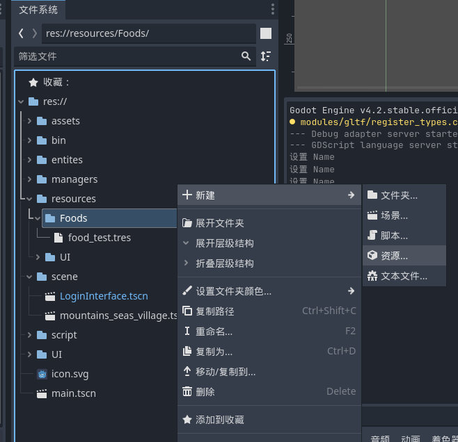

# Godot 使用说明

- 基于C++
- GDExtension不支持Godot4以下的版本

## 概述

- 程序参考代码

遇到不会的信息，可以参考github上Godot源码，其代码参考位置

1. 错误宏使用方法：`/core/error`
2. 使用样例：`/test/core/`

常见错误 

| 关键                                                         | 说明                                                         |
| ------------------------------------------------------------ | ------------------------------------------------------------ |
| 各种空指针错误                                               | `TIdleState * m_state_idle = NULL;` 指针初始化一定要指向空，防止一些不可名状的错误 |
| AttributeError: 'NoneType' object has no attribute 'Append':<br/>File "D:\A_CodeItems\A_immortal_hero_world\SConstruct", line 8:<br/>env.Append(CPPPATH=["src/include/"]) | 有可能是godot-cpp版本问题，建议换个源码版本                  |
| error LNK2019: 无法解析的外部符号                            | 必须.cpp中文件必须实现<br>在Sconstruct文件中没有正确引入对应的.cpp文件或.h文件 |
| error LNK2001: 无法解析的外部符号                            | 若是在使用多态的时候出现错误，父类虚函数没有默认方法<br>静态方法没有初始化，静态属性初始化时没有添加类名 |
| fatal error LNK1120: 1 个无法解析的外部命令                  | 可能是函数传递错误<br>需要引用传递:`void R(AAA* b)`<br>静态方法定义时没有添加类名 |
| core/extension/gdextension.cpp:629 - <br>No GDExtension library found for current OS and architecture<br> (windows.x86_64) in configuration file: res://bin/a.gdextension<br/>Failed loading resource: res://bin/a.gdextension. Make sure resources have been imported by opening the project in the editor at least once. | 若确定.lib文件存在，则可能是编译环境错误，Godot的提示并不准确<br>验证GCC，gcc -v |
| error C2504: “TMainNode”: 未定义基类<br>error C2027: 使用了未定义类型<br>出现了循环引用错误 | 在father.h文件中声明`class child;`<br>在father.cpp中引入头文件：`#include "child.h"` |
| 成功编译，但编译后子类不存在节点中                           | `register.cpp`中要保证，父类在子类前面进行注册               |
| error C2065: “TFSCINTERFACE”: 未声明的标识符<br>error C2027: 使用了未定义类型“TMOVESTATE” | 检测头文件的引用顺序                                         |
| 使用继承创建Godot节点，子类可通过静态方法，访问父类属性、方法<br>不相关的节点只能通过get_node等方法、获取分组节点，先获取到目标节点，再调用其节点中的方法 |                                                              |
| The local variable "name" is shadowing an already-declared property in the base class "Node". | 在 Godot 中，`Node` 类有一个内置的 `name` 属性，表示节点在场景树中的名称。 |
| The parameter "delta" is never used in the function "_physics_process()". If this is intended, prefix it with an underscore: "_delta". | Godot 建议：**如果函数参数不被使用，应该在其前面加上下划线 `_` 作为前缀**，这样可以明确表示这个参数是故意不使用的。 |
| Attempt to get non-existent interface function: 'get_godot_version2' | Godot-cpp版本与Godot的版本不匹配，一些函数在高级版本中废弃   |

## 备注\说明

### 一、优先使用Godot类或STL库

- 优先使用std库场景
  1. 纯C++模块，无脚本交互
  2. 高频访问的固定类型数据

- 优先使用Godot引擎的类场景
  1. 序列化（基于Variant类型实现）、信号、资源管理等依赖于Variant类型
  2. 与GDScript交互时，使用Godot容器

### 二、关于使用 const &

- 当创建一个非游戏的应用程序时，确保在项目设置中启用[低处理器模式](https://docs.godotengine.org/zh-cn/4.x/classes/class_projectsettings.html#class-projectsettings-property-application-run-low-processor-mode)以减少 CPU 和 GPU 占用。

- 资源类型优先使用 `const Ref<T>&` 

  ``` c++
  void set_texture(const Ref<Texture2D> & p_texture) 
  {
      // 参数传递阶段：零开销（无拷贝）。
  	// 赋值给成员变量时：发生一次拷贝（引用计数 +1）。
      texture = p_texture;
  }
  ```

- 其他类型是否推荐使用`const &`

  | **类型**       | **大小** | **拷贝成本**     | **推荐传递方式** |
  | :------------- | :------- | :--------------- | :--------------- |
  | `int`, `float` | 4-8 字节 | 极低             | 直接传值         |
  | `Vector2`      | 8 字节   | 低               | `const &` 或传值 |
  | `String`       | 变长     | 中等（引用计数） | `const &`        |
  | `Array`        | 变长     | 高（深层复制）   | `const &`        |
  | `Dictionary`   | 变长     | 高（深层复制）   | `const &`        |

### 三、循环引用错误

- **前向声明的本质**：编译器需要知道 `Node2D` 属于哪个命名空间，即使后续通过 `using namespace` 省略。

- **一致性要求**：Godot 的 C++ 绑定严格将类定义在 `godot` 命名空间内，前向声明必须匹配。

- 另外的，对于一些常用的基础类（比如String，Vector）会被间接引入（`object.h`头文件中包含），仍然推荐使用向前声明来**显式包含**头文件，在`.h`文件中声明，在`.cpp`文件中引入对于的文件

  ``` c++
  /* 向前声明 */
  namespace godot 
  {
      class Node2D; // 前向声明（必须在 godot 命名空间内）
      class String; // 一些基础类，也需要明确声明，显式包含头文件
  }
  ```

### 四、向前声明错误的情况

需要完全的定义的情况：

1. **Ref<>定义的类**：不能只使用向前声明，还需要.h文件，因为Ref<>是模板，需要完整的类定义
2. 继承的父类
3. 当使用向前声明，但是在.cpp中却没有引入对应的头文件，会有error C2139错误

``` c++
/* Ref<>需要完整的定义 */
#include "resources/keyboard.h"
godot::Ref<KeyBoradRes> current_music_set = nullptr;

/* 需要完整的定义  */
#include <godot_cpp/classes/object.hpp>
class TAutoStartManager : public godot::Object {}
```

### 五、应该使用完整的定义

- 为了明确使用的类，应该使用完整的类定义变量（在.h文件中明确使用的类）

``` c++
// 使用godot::明确使用的是Godot的类
godot::String default_res_path = "res://default_music_data.tres";
godot::Ref<KeyBoradRes> current_music_set = nullptr;

// 函数定义时也使用完整定义
void set_music_and_keyborad(const godot::String & key); 
```

### 六、关于命名空间

`using namespace godot;`建议在.cpp文件中使用，防止命名空间污染

### 七、多个gdextension文件

1. `register_types.h`中的`entry_symbol`名称不能重复

2. 不同的gdextensin中注册的dll等文件，其`register_types.cpp`中注册的类名称不能重复

   > 建议每一个类加入自己独特名称开头

### 八、关于使用什么对象保存

| 你的对象继承自                                               | 使用                                                |
| :----------------------------------------------------------- | :-------------------------------------------------- |
| `Node` 或其子类（`Node2D`、`Control`、`Camera3D` 等）        | **`Node *`**（或具体子类指针）                      |
| `Resource` 或其子类（`Texture2D`、`AudioStream`、`Script` 等） | **`Ref<T>`**                                        |
| `RefCounted`（自定义）                                       | **`Ref<T>`**                                        |
| `Object`（非 `RefCounted`）                                  | **`Object *`** （能使用具体的类型，就是用具体类型） |
| 纯 C++ 类（不继承任何 Godot 类）                             | 普通 C++ 指针或智能指针（如 `std::unique_ptr`）     |

## 生命周期

- GDExtension中的类注册为系统单例的时候就会调用类的构造函数
- 继承RefCounted的类，在构造函数中操作引用计数会出错，崩溃或内存泄漏
- 构造函数中不要调用任何Godot API，因为构造函数执行的时间早
- _ready()函数只有在加入场景树，才会调用
- 由于单例的生命周期由引擎管理，**通常建议单例的基类使用 `Object` 而不要使用 `RefCounted`**，避免因引用计数归零导致单例被意外释放

1. enterTree：节点添加到节点树时调用，每一个节点加入树都会调用

2. ready：`_ready`方法，优先初始化子类，再初始化父类（子类顺序是由上到下初始化）

3. process：

   1. _process每一帧都运行；delta = 1/帧数
   2. 移动距离$\times$delta可以使移动距离与帧率无关；1$\times$delta可以简单理解为每秒移动1像素

4. physic_process：物理计算一次调用，一般调用物理引擎时使用

5. exitTree：节点销毁调用

6. input：有输入时调用


``` c++
/* 只要键盘或鼠标按动，就触发当前方法 */
void _input(const Ref<InputEvent> &event);//输入按键调用
   
void T::_input(const Ref<InputEvent> &event){
    //UtilityFunctions::print("_input");
   	// 判断p是否按下
    if(event->is_action_pressed("p")){
        UtilityFunctions::print("stop");
    }  
    //C++示例方法，转换inputevent
    const InputEventKey *key_event = Object::cast_to<const InputEventKey>(*event);       
}
   
/* _unhandled_key_input */
void T::_unhandled_key_input(const Ref<InputEvent> &event){}
```

其他注意事项

1. 生命周期方法，初始化顺序是从上到下
2. C++的方法与GD脚本的方法函数名相同
3. 生命周期方法需要写在public下

## 数据类型

### 一、宏定义

停止宏，更好用，可以暂停Godot

``` c++
// 它在运行时触发错误并自动打开调试器断点，效果等同于编辑器内的“暂停游戏”：
ERR_BREAKPOINT_MSG("对象为空！请检查资源是否加载成功。");
return;

// 直接退出
CRASH_NOW_MSG("资源无效，游戏将退出。");
```

错误宏

``` c++
ERR_FAIL_NULL_MSG(a, "xxxxx");    // 判断指针a是否为空,并输出错误信息，程序返回
ERR_FAIL_NULL_EDMSG(a, "xxxxx2"); // 判断指针a是否为空,并输出错误信息，程序返回

ERR_FAIL_NULL(a);     // 判断是否为空，空输出a为空
ERR_FAIL_NULL_V(a, 1);// 第2个参数不知道是什么

ERR_FAIL_V_MSG(nullptr, err); // 带返回值的，错误信息

// 通用错误宏
ERR_FAIL_MSG("Error fail msg");     // 打印错误信息，程序返回
ERR_FAIL_EDMSG("error fail edmsg"); // 错误打印，通知编辑器
ERR_FAIL_V(b); // 程序错误，并返回其值b

ERR_PRINT("Error print"); // 打印错误，程序继续执行
ERR_PRINT_ED("Error print ed"); // 通知编辑器，程序继续执行
ERR_FAIL();                     // 程序返回
```

检查宏

``` c++
// 检查类型，可以检查任何宏
CHECK(int(map["Hello"]) == 0);
```

其他宏

``` c++
CHECK_EQ(a1, a1); // compare self
CHECK_FALSE(a1 != a1);
CHECK_EQ(a1, a2); // different equivalent arrays
CHECK_FALSE(a1 != a2);
CHECK_NE(a1, other_a); // different arrays with different content
CHECK_FALSE(a1 == other_a);
```

### 五、Variant类型转换

- Godot的万能类型，可以转换为Godot的任意类型
- 要实现序列化，就应将变量类型转换为Godot容器（Array、Dictionary等）

显示转换（适用于转Array、Dictionary、Vector2等）

- 一般要使用类型检测，不然会出错停止

``` c++
Vector2 my_v = my_variant.operator Vector2(); // 转换为vector2
Array my_a = my_variant.operator Array(); // my_variant是variant类型
Dictionary my_d = my_variant.operator Diactionary(); // 直接转换

/* 测试 */
// 检测是不是字典类型
if (my_variant.get_type() == Variant::DICTIONARY) {
    Dictionary my_dict = my_variant;
} else {
    UtilityFunctions::print("Variant is not a Dictionary!");
}
```

**使用cast_to转换**

- 适用于 **`Object` 类型之间的转换**（如从 `Node`到 `CharacterBody3D`类型）。
- 基本就是Node类转换为其他Node子类
- 如果转换失败，`cast_to` 返回 `nullptr`。
- **仅适用于 `Object` 派生类**，不能用于 `int`、`float` 等基本类型。

``` c++
// 使用 Object::cast_to<T>（推荐）
Node *node = v;
// 从node转换为Node2D
Node2D *player = cast_to<Node2D>(node);
```

**隐式转换，使用`=`或`Ref<>`**

- 适用于 Godot 的 **`Ref<>` 智能指针系统**（如 `Ref<Resource>`, `Ref<Node>` 等）。
- 当使用Dictionary或Array保存`Ref<>`时，使用隐式转换

``` c++
/* 情况1：Variant 存储的是 Resource 类型 */ 
Variant v = ResourceLoader::get_singleton()->load("res://texture.png");
Ref<Texture2D> texture = v; // 直接赋值（隐式转换）

/* 情况2：Variant 存储的是 Node 类型 */ 
Variant node_v = get_node("Player");
Node *node = node_v; // 直接转换为 Node*
```

### 六、Dictionary

- Godot所有变量都需要使用`cast_to`转换
- 不同的Dictionary类型
  - 如果需要存储多种类型的数据，使用 `Dictionary`。
  - 如果需要存储特定类型的数据，使用 `TypedDictionary<K, V>`。
  - 如果需要保持键值对的顺序，使用 `OrderedDictionary`。
  - 如果需要高性能的密集字典，使用 `PackedDictionary` 系列。


初始化方法：没有适合方法

Dictionary使用方法

``` c++
Dictionary map;
map["Hello"] = 0;
map[StringName("HelloName")]; //使用StringName效率好像要高一些
map[Vector2(10, 20)] = 30;

map.find_key(6).get_type();
map.make_read_only();
map.size();
map.get_key_list(ptr);
Array a = map.keys(); // 获取所有key

Variant val = map.get_key_at_index(0);
if(int(val) == 4);
```

### 七、Array类型

- Array可以存放任意类型（**可同时存放不同的类型，但只能是Godot内部支持对象**）
- 需要使用`cast_to`进行类型转换
- 如果需要高性能的密集数组，使用 `PackedArray` 系列。内存紧凑，性能高。

**注意**：当使用ClassDB::add_property添加外部属性，其类型是Array的时候，对应存储变量必须是Public权限，private权限、protected权限都有可能造成Array的值只能使用1次就被释放（版本：4.4），Dictionary字典类型就可以完美保存

Array常用使用方法

``` c++
/* 创建数组 */
Array arr; // 创建空数组
Array arr = Array::make(1, 2, 3, "hello", true); // 创建带初始值的数组

/* 额外方法 */
arr.size(); 
arr.front();
arr.back();
arr.remove_at();
arr.count(2);
arr.max(); // 最大
arr.min(); // 最小
arr.slice();
arr.pick_random(); //随机获取一个数
```

Array常用使用方法-添加元素

- **`append(value)`**：在数组末尾添加一个元素。
- **`push_back(value)`**：与 `append` 相同。
- **`insert(position, value)`**：在指定位置插入一个元素。

```c++
my_array; // [1, 2, 3]
my_array.append(4);          // [1, 2, 3, 4]
my_array.push_back(5);       // [1, 2, 3, 4, 5]
my_array.insert(2, 99);      // [1, 2, 99, 3, 4, 5]
```

Array常用使用方法-删除元素

- **`remove(position)`**：删除指定位置的元素。
- **`erase(value)`**：删除第一个匹配的元素。
- **`pop_back()`**：删除并返回最后一个元素。
- **`pop_front()`**：删除并返回第一个元素。
- **`clear()`**：清空数组。

```c++
my_array.remove(2);          // 删除索引为2的元素
my_array.erase(3);           // 删除第一个值为3的元素
Variant last_element = my_array.pop_back();  // 删除并返回最后一个元素
Variant first_element = my_array.pop_front(); // 删除并返回第一个元素
my_array.clear();            // 清空数组
```

Array常用使用方法-查找元素

- **`find(value)`**：返回第一个匹配元素的索引，未找到返回 `-1`。
- **`has(value)`**：检查数组是否包含某个值。包含返回真

```c++
int index = my_array.find(2);  // 返回值为2的索引
if (my_array.has("hello")) {
    Godot::print("Found 'hello'");
}
```

Array常用使用方法-排序/ 反转

- **`sort()`**：对数组进行升序排序。
- **`sort_custom(callable)`**：使用自定义函数排序。
- **`reverse()`**：反转数组。

```
my_array.sort();  // 升序排序
my_array.reverse();  // 反转数组
```

TypedArray使用方法

- 类型安全：只能存储指定类型的元素。
- 性能优化：由于类型固定，访问元素时无需类型检查。
- 支持的类型：`Node`, `Resource`, `Object` 等

``` c++
/* 存放一般数据 */
TypedArray<int> w;
w.push_back(1);

/* 存放字典类型 */ 
Dictionary w2; // 定义一个字典
TypedArray<Dictionary> w1;
w1.push_back(w2);

/* 存放类 */
TypedArray<TResNode> w3;
w3.push_back(this);
```

## 类型转换方法

- `String::num`转换的是float/double类型
- `String::num_int64`转换的是整形

#### Ⅰ、数字转String

``` c++
/* 数字转换为string */
float pi = 3.14159f;

// 方法2: String::num，性能最佳
String str = String::num(pi);
// 方法1: Variant 转换
String str = Variant(pi);
// 方法3: String::num 带精度
String str = String::num(pi, 3);  // 保留3位小数
// 方法4: UtilityFunctions::str
String str = UtilityFunctions::str(pi);
```

#### Ⅱ、String转数字

``` c++
/* string转换为数字 */
String my_string = "12345";

int my_int = my_string.to_int();  // 基本转换，性能最佳
int my_int = Variant(my_string);  // 自动转换为int
int my_int = UtilityFunctions::int(my_string);  // 使用UtilityFunctions
```

### 类型转换

1. 使用Ref<>定义的资源类，优先使用=转换（隐式转换）
2. 对于裸指针，多使用`cast_to`转换
   - 例如Dictionary中存放了Node类型
   - Node类型转Node2D类型

### `Ref<T>`类型转换

方法一：使用 `.ptr()` + `cast_to<T>()`（推荐）

- 这是最安全、最常用的方法：

```c++
Ref<Resource> resource = ResourceLoader::load("res://data/player_data.tres");

// ✅ 通过 .ptr() 获取裸指针，然后用 cast_to 转换
PlayerData* data = cast_to<PlayerData>(resource.ptr());
// 注意这里，如果失败，data的值是nullptr
if (data) {
    // 转换成功
    Ref<PlayerData> player_data = data;  // 从裸指针创建 Ref
}
```

🥈 方法二：使用 `Ref<T>` 的赋值转换（如果类型已知）

- 如果已经在编译时知道具体类型，可以直接赋值：
- **注意**：如果 `resource` 实际不是 `PlayerData`，`player_data` 会变为 `null`（安全转换，不会崩溃）。

```c++
Ref<Resource> resource = load_resource();

// ✅ 直接赋值（会自动检查类型）
Ref<PlayerData> player_data = resource;

// 检查是否有效
// 注意这里，如果失败player_data的值是null，使用is_valid判断
if (player_data.is_valid()) {
    player_data->set_name("Hero");
}
```


## 对象相关

### 一、memnew（内存分配）

1. 注意，当memnew创建的内容**添加到【场景树】后**，就不能使用memdelete删除了，因为其管理者变更为了场景树，优先使用queue_free()方法

2. 4.3开始，Godot不能使用new、delete、malloc等C++关键字；

3. Godot提供了内存分配方法

   `memalloc()、memrealloc()、memfree()`对应C中`malloc()、realloc()、free()` 

   `memnew()、memdelete()`对应C++中`new()、delete()` 

4. 对于动态内存, 提供了PoolVector<>模板.PoolVector是一个标准的Vector类

   PoolVectors允许快速读/写并保持锁定直到它们超出作用域.

   PoolVectors应该用于小型动态内存操作, 因为read()和write()对于大量访问来说太慢了

   ``` c++
   PoolVector<int> data; //创建PoolVector缓冲区
   // 读取
   PoolVector<int>::Read r = data.read()
   int someint = r[4];
   // 写入
   PoolVector<int>::Write w = data.write()
   w[4] = 22;
   ```

对于在Godot GDExtension中，如果要使用`memnew()`方法，一定要记得使用`memdelete()`方法，除非这个类不需要释放

``` c++
// 创建对象
AudioStreamPlayer * au = memnew(AudioStreamPlayer);
// 删除对象
memdelete(au);
// 不需要手动删除的对象
Ref<AudioStreamPlayer> au = memnew(AudioStreamPlayer);
```

删除节点

- `void queue_delete(obj: Object)`：（SceneTree方法）当前节点会在帧末尾删除
- `void queue_delete()`：（NODE节点下的方法）当前节点会在帧末尾删除，其子节点也会被删除

### 二、抽象类（C++）

与C++不同的位置是，在register_types.cpp中注册抽象类

- `ClassDB::register_abstract_class<IEnemy>();`注册抽象类
- `ClassDB::register_class<Goblin>();`抽象类的子类

另外的，在GDScript中，继承该类也需要实现对应的方法

``` python
# 继承IEnemy类
extends IEnemy

func attack():
    print("Dragon breathes fire!")

func get_damage() -> int:
    return 50
```

### 三、Object对象

1. 继承Object可以在GDScript中直接使用new初始化

3. GDScript中使用new()，创建的对象，必须显式调用 `free()` 或 `queue_free()`销毁对象

   > 1-如果对象在程序退出前始终有效（如全局单例、常驻工具类），且 **没有主动释放的需求**，Godot 会在程序关闭时自动清理所有未释放的 `Object` 派生类实例（包括 GDExtension 中的 C++ 对象）。
   >
   > 2-对象在程序退出之前销毁，一定要调用`free()`方法
   >
   > 3-销毁对象前应断开所有信号连接

``` c++
#include <godot_cpp/classes/object.hpp> // 需要完整的定义
class MyObject : public Object {
    GDCLASS(MyObject, Object); // 必须注册
}

// GDScript中调用
var obj = MyObject.new()
obj.do_something()  // 输出 "Working..."
obj.free()          // 必须手动释放，否则内存泄漏
// 不调用 free() 会导致析构函数不执行
```

### 四、RefCounted对象

1. 继承RefCounted，实现方式与Object相同，但是比Object多了一个自动管理内存功能
2. 需要跨脚本共享且自动管理生命周期、**在GDScript 交互脚本中可随意传递和存储** 
3. 避免手动释放，减少错误：工具类（如数学库）、数据资源（如配置、存档）

``` c++
class MyResource : public RefCounted {
    GDCLASS(MyResource, RefCounted); 
}

// 在GDScript中调用
// 无需手动释放，引用计数归零时自动销毁
var res = MyResource.new()  // 自动管理内存
print(res.get_data())       // 输出 "Hello"
```

#### Ⅰ、Ref<>使用说明

1. 使用了`Ref<>`定义变量，不需要使用指针，其本身就是指针，
2. `Ref`：Reference继承自Object并保存引用计数. 它是引用计数对象类型的基础

`Ref<T>`定义的类需要完全的定义，不能使用向前声明，必须引入头文件

``` c++
// 自定义资源类
#include "resources/keyboard.h"
godot::Ref<KeyBoradRes> current_music_set = nullptr; 

// 使用系统的资源类
#include <godot_cpp/classes/audio_stream.hpp>
godot::Ref<AudioStream> aa = nullptr;
```

使用STL标准库不能与Ref混用

> 注意：当需要销毁current_music_object对象时，需要先销毁map内的godot::AudioStreamPlayer对象，使用memdelete(i.second);

``` c++
// 正确使用方法
std::map<String, godot::AudioStreamPlayer * > current_music_object {};

// 错误方法，map（包括其他STL容器）内不能添加Ref<>
std::map<String, godot::Ref<godot::AudioStreamPlayer> > current_music_object {};
```

#### Ⅲ、Object与RefCounted的区别

1. `Object`与`RefCounted`除了内存管理不同，其他方面基本相同

2. 信号连接周期不同，`Object`对象释放时不会自己断开信号连接（可能会出现不可预知的BUG），而`RefCounted`会自动断开连接

3. `RefCounted`多线程安全，适合跨线程传递，`Object`需要自行处理线程同步

4. 一般对象应继承自`RefCounted`更方便

   对生命周期完全控制的对象（单例、全局管理器等）使用`Object` 

5. 在GDScript中使用`var my_obj = MyClass.new()`创建的类，要继承`RefCounted`

   **原因**：GDScript 的变量系统本质上就是一套引用计数。如果这个类继承自 `Object`，GDScript 拿到的是一个裸指针。它不知道这个指针什么时候会失效，也无法参与它的生命周期管理。这极容易造成悬空指针或内存泄漏。

6. 在GDExtension中使用注册单例，GDScript中只是调用方法`MySingleton.do_something()`，应继承`Object` 

   **原因**：这个对象的生命周期**完全由 C++ 和 Godot 引擎控制**。它是在 GDExtension 初始化时由 `ClassDB` 注册的，并在引擎关闭时销毁。GDScript 只是通过全局名称去调用它的方法，它**从未**“拥有”过这个对象。因此，你不需要也不应该让 GDScript 去管理它的引用计数。

### 五、new

1. `new`只能用于GDScript中定义的类、节点
1. 不能调用GDExtension类的构造方法

``` python
# 定义GDScript 中定义的类
class MyGDScriptClass:
    pass
# 调用   
var obj = MyGDScriptClass.new()
```

### 六、ClassDB.instantiate

1. `ClassDB.instantiate()` 实例化 **GDExtension C++ 类**唯一可行方案。
2. 这样创建的MyCPPClass是完全新的，独立的类，可能与gdextension中使用的不是同一个


``` python
# C++ 类 "MyCPPClass" 继承 Object
# as MyCPPClass中MyCPPClass是类型
var obj = ClassDB.instantiate("name_MyCPPClass") as MyCPPClass
```

### 七、cast_to

- 主要用于`Object *`及其派生类之间的转换
- 比如使用`get_child()`获取的一个节点
- Dictionary字典保存的变量
- `Object*`转换为`Node*`

``` c++
// 转换为PackedScene
Ref<PackedScene> temp_scene = Object::cast_to<PackedScene>(my_scene);
Node * temp_player = temp_scene->instantiate();

// 转换为SceneTree类型
SceneTree * tree = Object::cast_to<SceneTree>(main_loop);
```


## 信号使用

### 一、使用说明

1. Godot操作方法：连接信号方法$\to$ 连接到脚本（选中自定义类）$\to$ 接受方法旁的“选取”

2. 一个信号只能连接到同一个 Callable 一次。

   如果该信号已经连接，除非该信号是使用 CONNECT_REFERENCE_COUNTED 连接的，否则该方法会返回 ERR_INVALID_PARAMETER 并推送一条错误消息。

   为防止这种情况，请首先使用 is_connected() 检查已存在的连接。

3. 操作方法：连接信号方法$\to$ 连接到脚本（选中自定义类）$\to$ 接受方法旁的“选取”

### 二、信号声明

1. 信号定义、发射、连接方法，都可以在任意位置
2. 信号定义、发射、连接方法，都不在一个文件中，需要获取对应的节点
3. 信号声明，可以在任意文件中

``` c++
// ADD_SIGNAL需要头文件class_db
#include <godot_cpp/core/class_db.hpp>

// 创建信号-带参数信号
ADD_SIGNAL(MethodInfo(
    "game_stop",//信号名称
    PropertyInfo(Variant::STRING, "data"), // 信号参数 1
    PropertyInfo(Variant::INT, "amount") // 信号参数 2
));

// 创建信号-普通信号
ADD_SIGNAL(MethodInfo("game_stop"));
```

### 三、发射信号

GDScript发射信号：需要获取定义信号的节点

``` python
get_node("节点名称")->emit_signal("xx");
```

GDExtension发射信号

``` c++
// 当前类中定义了信号
emit_signal("信号名称");
emit_signal("信号名称", "参数1");

// 发射其他类中定义信号，需要先获取定义信号的类
get_node<Node>("节点名")->emit_signal("信号名称");
```

### 四、信号的处理方法

- 一定要设置bind_method方法，不然无法触发信号处理方法

``` c++
// ClassDB可能需要头文件
#include <godot_cpp/core/class_db.hpp>

/* 暴露信号的触发方法到GDScript */
// up: 供GDScript调用的方法名
// up_testst：up触发的C++方法
ClassDB::bind_method(D_METHOD("up"), &TTest::up_testst);

/* 设置响应方法 */
void Test::up_testst(){ //...}
```

### 五、连接信号

#### Ⅰ、无参数

- 格式：`connect("信号名称", Callable(类, "触发的GDScript可调用的方法"))` 
- 信号连接方法，可以在任意地方

GDExtension发射信号，触发GDExtension方法

``` c++
/* 方式一 */ 
// 1.当前类定义了信号：game_stop
// 2.触发当前类的方法
connect("game_stop", Callable(this, "up"));

/* 方式二  */
// 1.当前类定义了信号：game_stop
// 2.触发其他类方法
Node *p = get_node<Node>("aim"); // 获取其他类
connect("game_stop", Callable(p, "up"));

/* 方式三 */ 
// 1.aim类中定义了信号:game_stop
// 2.触发aim中方法up
get_node<Node>("aim") 
 	->connect("game_stop", Callable(this, "up"));

/* 方法四 */ 
// 1.当前类没有定义信号
// 2.当前类没有触发方法
Node *p = get_node<Node>("aim"); // 获取触发方法
get_node<Node>("Area2D") // 获取信号
 	->connect("game_stop", Callable(p, "up"));
```

GDExtension发射信号，触发GDScript方法

- 由于GDExtension要发射信号，所以信号的定义要在GDExtension中

``` c++
// 定义信号
ADD_SIGNAL(MethodInfo("init_b");
// GDExtension发送信号，初始化完成
TSignalController::get_singleton()->emit_signal("init_b"); 
```

- 在GDScript中连接信号，设置触发方法，这个连接可以在任意位置

``` python
func _ready() -> void:
	# 如果，当前 optiontion button 个数为0，删除按钮不可选
	TSignalManager.connect("init_b", do_deletebutten)
	pass

# 触发方法
func do_deletebutten() -> void:
	pass
```


#### Ⅱ、带参数

1. connect中Callable方法只能触发GDScript能调用的方法（使用CLassDB::bind_method绑定的方法）

2. 出现错误：

   > Cannot connect to 'animation_finished': the provided callable is not valid: 

   应检测`D_METHOD`的绑定方法与`Callable()`中的方法名是否一致

携带参数的bind方法

``` c++
/* 定义可调用方法 */ 
ClassDB::bind_method(D_METHOD("destroy_tetrominoes", "a", "b"), &aa::destroy);

/* 连接信号 */
int a = 100;
anim_player->connect(
    "animation_finished", // anim_player节点的信号
    // _on_animation_finished：触发的方法，需要在bind_method中绑定
    // bind(a)：绑定的参数，可以是任何值，节点，值都行
	Callable(this, "destroy_tetrominoes").bind( a ));

/* 调用方法 */
// const String &anim_name：AnimationPlayer的finished信号默认绑定参数
// int a：我们自定义的绑定参数
void aa::destroy(const String &anim_name, int a)
{
    // 动画节点第一个参数是默认传递的
    if (anim_name == "play") { \\...    }
}
```

## Resource相关

### 一、使用说明

1. **资源类可以直接使用，他在游戏中是唯一的** 

2. 资源节点需要在`register_types.cpp`中注册，如果，没有注册，会有不能打开资源文件错误

3. 静态的数据，不会修改的信息，都可以写成资源（可以理解为数据库）

4. 同时，一个资源类（C++文件）代表一类资源，可用这个资源生成具体的资源文件（.tres）

   比如，编写weapen.cpp（武器资源）可生成dadao.tres（大刀）、xiaodao.tres（小刀）

资源参数说明

| 名称                    |                                                              |
| ----------------------- | ------------------------------------------------------------ |
| resource_local_to_scene | 一个资源文件应用于多个地方时，（true）可保证每一个资源都独立 |
|                         |                                                              |

### 二、基础的资源文件

#### Ⅰ、创建.h文件

- 头文件：`#include <godot_cpp/classes/resource.hpp>`
- 必须继承Resource类型

需要在Godot编辑器中修改的资源：

``` c++
using namespace godot;
class TFood : public Resource
{
    GDCLASS(TFood, Resource);
public:
    /* 基础属性 */
    String m_name = "";
    Variant m_level;
protected:
    static void _bind_methods();

private:
    // 修改属性方法
    void set_name(const String & s);
    String get_name();
}
```

不需要在Godot编辑器中修改：

- 同样不需要.cpp文件

``` c++
class TFood : public Resource {
    GDCLASS(TFood, Resource);
public:
    /* 基础属性 */
    String m_name = "";
    Variant m_level;
protected:
    // 核心，在_bind_methods()后添加{}
    static void _bind_methods(){};
}
```

#### Ⅱ、创建.cpp文件

普通资源属性（`int、bool、float`等基础类型）

``` c++
#include "food.h"

void TFood::_bind_methods() {
    /* 设置可在编辑器修改 */
    ClassDB::bind_method(D_METHOD("set_name_a", "a"), &TFood::set_name);
    ClassDB::bind_method(D_METHOD("get_name_a"), &TFood::get_name);
    
    ClassDB::add_property("TFood",
     	PropertyInfo(Variant::STRING, "Name"),
        "set_name_a", // 调用的是godot绑定方法
        "get_name_a");// 调用的是godot绑定方法
}
/* 在编辑器修改的具体逻辑 */
void TFood::set_level(const int & a){
     m_name = a;
};
int TFood::get_level(){
     return m_name;
}; 
```

特殊类型（非基础类型，如`int、bool`等），添加一般使用`OBJECT`类型

``` c++
#include "food.h"

void TFood::_bind_methods() {
    ClassDB::bind_method(D_METHOD("set_name", "a"), &TFood::set_name);
    ClassDB::bind_method(D_METHOD("get_name"), &TFood::get_name);
    ClassDB::add_property("TFood",
        // 使用特殊的OBJECT类型
     	PropertyInfo(Variant::OBJECT, "Name"), // 修改地方
        "set_name",
        "get_name");
}
// 对应于不是基础类型的使用Variant类型
void TFood::set_level(const Variant & a){
     m_level = a;
};
Variant TFood::get_level(){
     return m_level;
}; 
```

#### Ⅱ、编辑器创建tres文件

使用Godot创建资源，创建后的资源类（.tres）文件，加载到其他节点即可使用




### 三、ResourceLoader

1. 头文件：`#include <godot_cpp/classes/resource_loader.hpp>` 
2. 场景类型头文件：`#include <godot_cpp/classes/packed_scene.hpp>`
3. 类型：

   - Ref<PackedScene>：场景资源（.tscn）
   - Ref<Texture2D>：图片纹理，图片资源
4. 如果先前已加载对该资源的引用并且该引用在内存中（已实例化）, 则资源加载器将返回该引用. 这意味着只能同时从磁盘上引用的文件加载一个资源.

``` c++
/* 方式一，通过对象加载 */
ResourceLoader *R = new ResourceLoader();
Ref<PackedScene> PS = R->load("res://units/enemy_wolf.tscn","PackedScene");

/* 方式二，通过单例模式加载 */
Ref<PackedScene> PS = ResourceLoader::get_singleton()
    ->load("res://path/to/your/resource.tres");
```

## SceneTree

1. 头节点：`#include <godot_cpp/classes/scene_tree.hpp>` 

``` c++
// 获取场景树
SceneTree *tree = Node::get_tree();

// get_current_scene():获取当前场景的根节点
Node *root = tree->get_current_scene();
// 获取
SceneTree::get_singleton()->initialize();
```

### 一、实例化场景

- 通过ResourceLoader实例化场景添加，节省不必要的资源开支
- **场景优先保存在资源中，而不是保存路径**，再使用load加载
- 即使保存在资源中的场景也要使用`instantiate`实例化 

``` c++
/* 方式一，通过对象加载 */
ResourceLoader *R = new ResourceLoader();
Ref<PackedScene> PS = R->load("res://units/enemy_wolf.tscn","PackedScene");

/* 方式二，通过单例模式加载 */
Ref<PackedScene> PS = ResourceLoader::get_singleton()
    ->load("res://path/to/your/resource.tres");

// 初始化，元素初始化，
// instantiate初始化前要检查PS是否为空
Node *b = PS->instantiate();

// marker2d加载敌人素材
m1->add_child(b);

// 判断节点是否加载成功
PS.is_valid()
```

#### Ⅰ、场景切换

- 只能用于游戏场景切换，因为他会释放所有节点，再新建节点，
- 场景切换要进程场景初始化操作，加载
- 头文件：scene_tree()

``` c
// 获取场景树
SceneTree *t = Node::get_tree();
// 切换场景，使用路径
t->change_scene_to_file("res://game2.tscn");

// 使用pack，节点对象
Ref<PackedScene> PS = ResourceLoader::get_singleton()
    ->load("res://urce.tscn");
PS->change_scene_to_packed(packed_scene);

// 切换场景方法
t->call_deferred("change_scene_to_file", "res://bat2.tscn");
```

#### Ⅱ、分组

获取分组

``` c++
// 获取场景树
SceneTree * tree = get_tree();
    
// 获取分组中的所有节点
Array a = tree->get_nodes_in_group("组名");
Node * ab = cast_to<Node>(a[0]); // 转换节点，调用a[0]
ab->get_name(); // 获取节点名称
```

添加删除分组

- 需要引入SceneTree头文件

``` c++
t->add_to_group("组名"); // 将节点t添加进分组
t->remove_from_group("组名"); // 将节点t从分组删除
```

其他方法

``` c++
/* 调用分组中公共方法 */
// 获取场景树
SceneTree *t = get_tree();
// 调用分组empy的脚本中ttt1方法
t->call_group("empy", "ttt1");

/* 动态添加分组 */
/* 使用get_node获取指定节点 */
Sprite2D *root1 = get_node<Sprite2D>
    ("/root/Node2D/Test/Sprite2D");
root1->add_to_group("empy");
```


## 文件系统

### 关于导出后资源文件的读写问题

`res://`目录情况

- 导出后**不能写入**，只能**读取**

- 读取路径使用`res://`即可（`res文件`位置应位于导出文件`.exe`文件的同级目录）

- 也可在场景中创建脚本引入（未测试，应该会直接导出）

  这种方式，只是声明这些资源需要引用，导出时要导出，使用时就正常使用（使用`res://路径`获取）

  ``` python
  # 方式一
  @export var my_resource: Resource = preload("res://path/to/A.tres")
  
  # 方式二
  const DEPENDENCIES = [
      preload("res://resources/A.tres"),
  ]
  ```

`user://`目录情况：导出后既能读取，又能写入，方便好用

### 关于保存游戏路径

1. `user://`：系统默认的保存位置

   可以直接打开数据存放位置：$项目\to 打开“用户数据”文件夹$

   **可读写**：无论是否导出，`user://` 目录始终可写。

   **跨平台兼容**：路径自动适配不同操作系统（如 Windows 的 `%APPDATA%`、Linux 的 `~/.local/share`）14。

   **独立于项目**：数据保存在用户设备上，不会被打包进游戏

2. `res://`：资源目录

   **导出后 `res://` 不可写**：如果尝试在导出后写入 `res://`，会导致错误

关于游戏存档格式

1. `.tres`：人类可以看懂得保存格式（Debug会用）
2. `.res`：更好得数据安全和游戏性能

### 一、FileAccess

#### Ⅰ、读取文件

- 头文件：`#include <godot_cpp/classes/file_access.hpp>`

- 文件读取类型

  | KEY                    | v    |
  | ---------------------- | ---- |
  | FileAccess::READ       | 1    |
  | FileAccess::WRITE      | 2    |
  | FileAccess::READ_WRITE | 3    |
  | FileAccess::WRITE_READ | 7    |

``` c++
// 读取文件
Ref<FileAccess> f = FileAccess::open("Path", FileAccess::READ);
// 关闭文件
f->close(); 

String a = f->get_as_text(); // 将FileAccess类型转换为字符串
Vector<String> header = f->get_csv_line(); // Default delimiter: ","
Vector<String> row1 = f->get_csv_line("~"); // 使用"~"分割字符串
```

#### Ⅱ、检查文件存在

- 头文件：`#include <godot_cpp/classes/file_access.hpp>`

``` c++
if (!FileAccess::file_exists(path)) {
   UtilityFunctions::print("文件不存在: ", path);
   return false;
}
```

#### Ⅲ、删除

- 头文件：`#include <godot_cpp/classes/dir_access.hpp>`

``` c++
 // 检查文件是否存在

// 获取文件所在目录
String base_dir = path.get_base_dir();
String file_name = path.get_file();
        
// 打开目录
Ref<DirAccess> dir = DirAccess::open(base_dir);
if (dir.is_null()) {
    UtilityFunctions::print("无法打开目录: ", base_dir);
    return false;
}
        
// 删除文件
Error err = dir->remove(file_name);
if (err == OK) {
    UtilityFunctions::print("成功删除文件: ", path);
    return true;
} else {
    UtilityFunctions::print("删除失败，错误码: ", (int64_t)err);
    return false;
}
```


### 二、JSON

1. Godot内置呢JSON解析方法，不用使用jsoncpp
2. 注意：Json类型不能通过`ClassDB::add_property`方式添加进Godot

**读取/保存**本地json文件，需要`FileAccess`类

- json头文件：`#include <godot_cpp/classes/json.hpp>` 
- 文件加载类：`#include <godot_cpp/classes/file_access.hpp>` 

``` c++
Ref<FileAccess> f = FileAccess::open("Path", FileAccess::READ);
String a = f->get_as_text(); // 将FileAccess类型转换为字符串
f->close(); // 关闭文件
```

**parse**：json文本（字符串）转json对象

- `Error parse( String json_text, bool keep_text=false )`：尝试解析json文本
- `Variant parse_string( String json_string ) static`: 试图解析提供的 `json_string`，并返回解析后的数据。如果解析失败，返回 `null`。

``` c++
/* 静态方法-parse_string */
// 解析字符串，并转换为Dictionary类型
Dictionary json = JSON::parse_string(json_text);
UtilityFunctions::print(json["1"]);
json.get("1", NULL); // 字典的获取方法


/* 使用Json对象 */
JSON * j = memnew(JSON); // 创建一个新Json对象，一定要用memnew方法
j->parse(a); // 解析json字符串
Dictionary z = j->get_data(); // 获取解析到的json数据，并使用字典保存
Array z = j->get_data(); // 获取解析的json数据，使用Array保存
z.get("1", null); // 字典获取方法，没有为空
z["1"]; // 字典获取方法
```

**stringify**：json对象转json文本（字符串），用于保存本地

- `String stringify(Variant data, String indent=””, sort_keys=true, full_precision=false )`

  将Variant变量转换为 JSON 文本并返回结果。

``` c++
Dictionary data_to_send = {"name":"my_dictionary","version":"1.0.0","entities":[{"name":"entity_0","value":"value_0"},{"name":"entity_1","value":"value_1"}]}
;
// 默认转换，不带格式
JSON.stringify(my_dictionary);
/* 转换样例：带\t
{
    "name": "my_dictionary",
    "entities": [
        {
            "name": "entity_0",
            "value": "value_0"
        }
    ]
}
*/
// 将Array转换为json
JSON.stringify(data_to_send, "\t")

```

获取其属性（不推荐使用）

``` c++
// 赋值方法
void TFather::get_res_from_father()
{
    father_1.push_back(111); // Array
    father_2["333"] = 333;  // Dictionary
    father_3 = get_node<Node>("../Node"); // 节点
}
// 子类调用赋值方法
TFather::get_res_from_father(); 
// 然后就可以使用父类属性了
UtilityFunctions::print(TResFather::father_1);
UtilityFunctions::print(TResFather::father_2);
UtilityFunctions::print(TResFather::father_3);
```

### 三、DirAccess

- 头文件：`#include <godot_cpp/classes/dir_access.hpp>`
- 作用，删除文件

``` c++
Ref<DirAccess> dir = DirAccess::open("res://地址");
if (dir.is_valid()) {
    Error error = dir->remove(path); // 删除文件
    if (error == Error::OK) {
        godot::UtilityFunctions::print("成功删除资源文件: ", path);  
        // 可选：通知文件系统更新
        // DirAccess::update_file_system();  
        return true;
    } else {
        godot::UtilityFunctions::print("删除文件失败，错误码: ", (int64_t)error);
        return false;
    }
}
```


### ConfigFile

- 一般是配置文件的保存
- 简单数据保存

``` c++
var config = ConfigFile.new();
config.set_value("名称", "key", value);
config.save("user://key");

var config = ConfigFile.new();
vart re = config.load("user://");
int b = re.get_value("名称", "key");

// 加密保存
var key = "xxxx"; // 加密密钥
config.save_encrypted_pass("user://key", key);
// 解密读取
config.load_encrypted_pass("user://key", key);
```

### ResourceSave

- 继承自Resource类得资源都可以使用ResourceSave保存
- Resource可以保存一整个节点，使用PackedScene保存
- OS::get_singleton()->get_user_data_dir()获取位置，待整理
- 问题1，若资源文件没有设置暴露给Godot编辑器，可能资源不会保存

验证是否资源文件存在

1. 直接使用`ResourceLoader::get_singleton()->load(save_path)`，若save_path不存在，会出现一个错误

2. 使用FileAccess::file_exists验证文件

   头文件：`#include <godot_cpp/classes/file_access.hpp>`

``` c++
// 验证文件是否存在
bool t = FileAccess::file_exists(save_path);
if (t) {}
```

保存方法：

- 头文件：`#include <godot_cpp/classes/resource_saver.hpp>`

``` c++
/* 声明：GameData是资源类型 */
// 一、需要手动释放
GameSetData * aa = memnew(GameSetData);
memdelete(aa); //必须手动释放

// 二、优先使用Ref定义，不用手动释放
Ref<GameSetData> aa = memnew(GameSetData);
aa->game_level = 100; // 设置游戏等级
aa->game_max_level = 1000; // 设置最大游戏等级
// 保存资源
ResourceSaver::get_singleton()->save(aa, "res://t_tetrominoes_data_001.tres"); 
```

读取方法

- 需要头文件：`#include <godot_cpp/classes/resource_loader.hpp>` 

``` c++
// 路径
String save_path = "res://t_tetrominoes_data.tres"; 
// 加载资源
Ref<Resource> resource_loader = ResourceLoader::get_singleton()->load(save_path); 
// 类型转换，因为load方法得到的是Ref<Resource>类型
Ref<GameSetData> game_set_data = resource_loader;
// 获取数据
int a = game_set_data->game_max_level;
```

GDScript脚本保存读取

``` python
# /* 保存 */
var data = GameData.new()
data.p = 100; # 保存数据
ResourceSaver.save(data, "user://...")

# /* 读取 */
# load返回的是Resource类，需要使用 as 转换为目标类
var data = ResourceLoader.load(save_path) as GameData;
aa = data.aa # 获取数据
```


## ClassDB方法

### 二、枚举类型

#### 方式一（有错误）

TFiniteStateMachine.h 头文件定义枚举

```c++

class TFiniteStateMachine : public godot::Object {
    GDCLASS(TFiniteStateMachine, godot::Object);
public:
    // 定义枚举
    enum class FSMStateType {
        kNull = 0,
        kBooting = 1,
        kIdle = 2,
        kRunning = 3,
    };
    // ...
};
```

TFiniteStateMachine.cpp 绑定常量

```c++

void TFiniteStateMachine::_bind_methods() {
    // 绑定枚举常量
    BIND_ENUM_CONSTANT(FSMStateType::kNull);
    BIND_ENUM_CONSTANT(FSMStateType::kBooting);
    BIND_ENUM_CONSTANT(FSMStateType::kIdle);
    BIND_ENUM_CONSTANT(FSMStateType::kRunning);
}
```

**在 GDScript 中：**

```python
TFiniteStateMachine.FSMStateType.kNull   # ✅ 正确
TFiniteStateMachine.FSMStateType.kBooting
```

#### 方式二（推荐）

定义枚举类型

```c++
void TFiniteStateMachine::_bind_methods() {
    // ✅ 定义方式一
    ClassDB::bind_integer_constant("TFiniteStateMachine", 
        "FSMStateType",                    // 枚举名称
        "kNull",                           // 枚举值名称
        static_cast<GDExtensionInt>(0) );
}
```

**在 GDScript 中：**

```c++
TFiniteStateMachine.FSMStateType.kNull   # ✅ 正确
TFiniteStateMachine.FSMStateType.kBooting
```

#### 枚举类型转换

``` c++
void TFiniteStateMachine::ChangeCurrentStateGd(Variant aim_state, Variant error_info) {
    // ✅ 1. 检查类型
    if (aim_state.get_type() != Variant::INT) {
        ERR_FAIL_MSG("aim_state must be an integer (enum value)");
    }
    // 使用宏定义检查
    ERR_FAIL_COND_MSG(aim_state.get_type() != Variant::INT, "aim_state must be an integer");
    
    // ✅ 2. 从 Variant 中取出 int 值，然后转换为枚举
    TIFsmState::FSMStateType a = static_cast<TIFsmState::FSMStateType>(aim_state);
}
```

### 给属性添加分组

``` c++
/* 
ADD_GROUP("分组名称","分组标识");
ADD_SUBGROUP("分组名称", "分组标识");
*/
// 设置分组表示，
ADD_GROUP("Group01","first_");
// 设置分组标识，二级分组
ADD_SUBGROUP("Group02", "first_second_");

/* 添加属性到分组中 */
ClassDB::add_property("Test",
    // 添加分组标识
    PropertyInfo(Variant::FLOAT, "first_second_xxxxx"),
    "set_radius",
    "get_radius");
```

### 四、bind_virtual_method

相对于C++ 的 virtual 为什么使用bind_virtual_method

1. bind_virtual_method可以暴露给 Godot 脚本系统，可被引擎识别为虚方法
2. bind_virtual_method绑定的方法可以使用call方法调用
3. 不供Godot重写直接使用C++的virtual

animal.h定义一个类

``` c++
// animal.h
class Animal : public Object {
    GDCLASS(Animal, Object)
protected:
    static void _bind_methods() {
        // 绑定方法
        ClassDB::bind_virtual_method(
            "Animal", D_METHOD("make_sound"), &Animal::make_sound);
    }
    
    virtual void make_sound() { 
        print("默认声音"); 
    }
};
```

GDScript子类定义

``` python
extends Animal
func make_sound():
    print("汪汪！")  # 成功覆盖 C++ 方法
```

### 五、bind_method

#### Ⅰ、参数相关

- 需要定义在`_bind_methods`中
- bind_method只有在可接受多个不同类型时，才使用Variant类型

✅ **不带参数的绑定方法** 

``` c++
/* ClassDB::bind_methond(D_METHOD("函数名"), 方法地址) */
ClassDB::bind_method(D_METHOD("start_test"), &Test::start_test);

// 不带参数的接收函数
void Test::start_test(){}
```

✅ **传递普通变量** 

- 推荐使用`const &`方式传递（**绝对的0拷贝**），避免了不必要的拷贝，同时保证函数内部不能修改数据

- 使用值传递，会发生一次拷贝，但Godot对内置类型进行了**写时复制 (Copy-on-Write, COW)** 机制

  > 虽然有COW机制，但是本身也会有些开销，也有可能进行拷贝
  >
  > **COW 的工作原理：**
  >
  > 1. **共享数据**：多个变量可以引用同一份底层数据
  > 2. **延迟拷贝**：只有在某个变量尝试修改数据时，才会真正创建副本
  > 3. **引用计数**：通过引用计数管理内存，当最后一个引用消失时释放内存

- 使用指针，Godot的Variant系统在转换时，通常以值或引用的形式传递这些对象，而不是直接传递指针。虽然技术上可能实现，但容易引入复杂性和风险（如空指针或所有权问题）

``` c++
// 绑定方法-定义
ClassDB::bind_method(D_METHOD("start_test", "a"), &Test::start_test);

// 错误不能使用&，无法通过编译
void Test::start_test(int & a){}; 

void Test::start_test(int a){}; // 正确
void Test::start_test(Dictionary a){}; // 正确，会发生拷贝，但有COW

void Test::start_test(const String & a){}; // 正确，a只读，优先const &定义
void Test::start_test(String & a){}; // 正确，a可修改
```

✅ **传递一些特殊的变量** 

- 当传入节点时：
  1.  `Object *`: 多种不同的类型，通常需要使用类型检查和cast_to转换
  2.  直接使用具体的节点类型指针（如 `Node*`）：明确知道类型
- 不推荐直接使用`Variant`类型，这样效率会低一些

``` c++
/* ClassDB::bind_methond(D_METHOD("调用的函数名", "参数1", "参数2"), 方法地址) */
ClassDB::bind_method(D_METHOD("start_test", "a", "b"), &Test::start_test);

void Test::start_test(Object * a, Node * b) {
	Area2D *t = cast_to<Area2D>(a); // 转换为适合类型
    bool t = a->is_class("Node"); // 检查类型
}
```

#### Ⅱ、绑定默认值

- 使用`DEFVAL()`设置
- 使用参数设置

``` c++
void set_autostart(bool enable, String parameter = ""); // c++方法定义

/**
 * DEFVAL只能设置最后几个参数
 */ 
ClassDB::bind_method(
    D_METHOD("set_autostart", "enable", "parameter"), 
    &TAutoStartManager::set_autostart, 
    DEFVAL(0), // 设置enable默认参数为0
    DEFVAL(String()) // 设置parameter默认参数为字符串""
);

/**
 * 手动设置默认参数（索引从0开始）
 */
MethodBind *mb = ClassDB::bind_method(
    D_METHOD("set_autostart", "enable", "parameter"), 
    &TAutoStartManager::set_autostart);

mb->set_default_argument(0, true);   // enable 默认 true
mb->set_default_argument(1, String()); // parameter 默认空
```

#### Ⅲ、关于返回值

**`bind_method` 支持的返回类型** 

- 优先返回具体的类型，不建议使用Variant类型

- 不推荐使用`const &`修饰返回变量，这牺牲了安全性且只带来了微小的性能提升（在GDExtension中）

- 关于Array数组

  数据项 < 100：直接返回，值拷贝

  数据项 > 1000：使用信号（访问频率小），包装器（访问频率大）

- 关于Dictionary字典

  键值对 < 50：直接返回，值拷贝

  键值对 > 200：使用信号

`bind_method` **不能直接绑定** `Object` 派生类的**裸指针**（如 `Node*`、`Resource*`），但可以绑定以下几种类型：

| 类型                         | 是否可以绑定 | 示例                             |
| :--------------------------- | :----------- | :------------------------------- |
| **`Variant` 基础类型**       | ✅ 可以       | `int`、`float`、`bool`、`String` |
| **`Variant` 容器**           | ✅ 可以       | `Array`、`Dictionary`            |
| **`Ref<T>`**（引用计数对象） | ✅ 可以       | `Ref<Texture>`、`Ref<Resource>`  |
| **`Object *`**（裸指针）     | ✅ **可以**   | `Object*`                        |
| **`Node *`**（裸指针）       | ❌ **不可以** | 这就是你遇到的错误               |
| **其他 `Object` 派生类指针** | ❌ **不可以** | `Control*`、`Window*` 等         |

使用样例：

``` c++
// 返回 int/float/bool 等基础类型（自动包装为 Variant）
int get_score() { return 100; }

// 返回 Godot 内置类型（隐式转换为 Variant）
Vector2 get_position() { return Vector2(10, 20); }

// 返回 Godot 对象（必须继承 Object/Resource）
Ref<Texture2D> get_texture() { return texture; }

// 返回 Array（Godot 风格）
Array get_player_info() {
    Array result;
    result.append("John");
    return result;
}

// 返回 Dictionary（更易读）
Dictionary get_stats() {
    Dictionary stats;
    stats["health"] = 80;
    return stats;
}
```

#### Ⅳ、绑定Resource类

- resource类应优先使用`const &` 
- 只有在接受多个不同类型的变量才使用Variant定义

关于Ref<>的注意事项，查看 **Godot核心/ Ref<>与错误** 

``` c++
/* 变量定义 */
Ref<Texture2D> _piece_texture = nullptr; // 图块纹理
/* 绑定方法的定义 */
void set_tetromino_position(const Array & a);
Array get_tetromino_position();


void PieceData::_bind_methods() 
{
    // 修改方法
    ClassDB::bind_method(
        D_METHOD("set_piece_texture", "s"), 
        &PieceData::set_piece_texture);
    ClassDB::bind_method(
        D_METHOD("get_piece_texture"), 
        &PieceData::get_piece_texture);
    // 参数
    ClassDB::add_property(
        "PieceData",
    	PropertyInfo(
            Variant::OBJECT, 
            "Piece Texture", PROPERTY_HINT_RESOURCE_TYPE, "Texture2D"),
        "set_piece_texture",
        "get_piece_texture");
}

// 方法实现
void PieceData::set_piece_texture(const Ref<Texture2D> &a)
{
    _piece_texture = a;
};
Ref<Texture2D> PieceData::get_piece_texture()
{
    return _piece_texture;
};
```


## PropertyInfo

### 一、基础类型

| 存储内容       | Variant 类型      | 提示类型                       | hint_string  | 示例            |
| :------------- | :---------------- | :----------------------------- | :----------- | :-------------- |
| 整数           | `Variant::INT`    | `PROPERTY_HINT_RANGE`          | `"0,100,1"`  | 血量、等级      |
| 浮点数         | `Variant::FLOAT`  | `PROPERTY_HINT_RANGE`          | `"0,1,0.01"` | 速度、百分比    |
| 布尔值         | `Variant::BOOL`   | `PROPERTY_HINT_NONE`           | `""`         | 开关、启用/禁用 |
| 字符串         | `Variant::STRING` | `PROPERTY_HINT_NONE`           | `""`         | 名称、描述      |
| 字符串（多行） | `Variant::STRING` | `PROPERTY_HINT_MULTILINE_TEXT` | `""`         | 长文本、描述    |

使用示例

```C++
PropertyInfo(Variant::INT, "health", PROPERTY_HINT_RANGE, "0,100,1");
PropertyInfo(Variant::FLOAT, "speed", PROPERTY_HINT_RANGE, "0,1000,0.1");
PropertyInfo(Variant::BOOL, "is_enabled");
PropertyInfo(Variant::STRING, "name");
// 多行
PropertyInfo(Variant::STRING, "description", PROPERTY_HINT_MULTILINE_TEXT);

// 整数范围
// 解释：0-100，步长1
PropertyInfo(Variant::INT, "health", PROPERTY_HINT_RANGE, "0,100,1");

// 浮点数范围
// 解释：0-500，步长0.1
PropertyInfo(Variant::FLOAT, "speed", PROPERTY_HINT_RANGE, "0,500,0.1");

// 百分比
// 解释：0-1，步长0.01
PropertyInfo(Variant::FLOAT, "volume", PROPERTY_HINT_RANGE, "0,1,0.01");

// 带滑块（默认显示数值输入框 + 滑块）
PropertyInfo(Variant::INT, "level", PROPERTY_HINT_RANGE, "1,99,1");
```

### 二、文件与路径

- 这个是存放字符串的的，类型需要使用STRING

| 存储内容     | Variant 类型      | 提示类型             | hint_string           | 示例     |
| :----------- | :---------------- | :------------------- | :-------------------- | :------- |
| 任意文件路径 | `Variant::STRING` | `PROPERTY_HINT_FILE` | `"*"`                 | 加载文件 |
| 场景文件路径 | `Variant::STRING` | `PROPERTY_HINT_FILE` | `"*.tscn"`            | 场景路径 |
| 资源文件路径 | `Variant::STRING` | `PROPERTY_HINT_FILE` | `"*.tres,*.res"`      | 资源路径 |
| 图片文件路径 | `Variant::STRING` | `PROPERTY_HINT_FILE` | `"*.png,*.jpg,*.svg"` | 图标路径 |
| 目录路径     | `Variant::STRING` | `PROPERTY_HINT_DIR`  | `""`                  | 导出目录 |

```c++
// 选择场景文件
PropertyInfo(Variant::STRING, "scene_path", PROPERTY_HINT_FILE, "*.tscn")

// 选择资源文件
PropertyInfo(Variant::STRING, "data_path", PROPERTY_HINT_FILE, "*.tres,*.res")

// 选择图片
PropertyInfo(Variant::STRING, "icon_path", PROPERTY_HINT_FILE, "*.png,*.jpg,*.svg")

// 选择任意文件
PropertyInfo(Variant::STRING, "file", PROPERTY_HINT_FILE, "*");
// 目录
PropertyInfo(Variant::STRING, "asset_folder", PROPERTY_HINT_DIR, "")
    
```

### 三、资源对象（大部分）

| 存储内容   | Variant 类型      | 提示类型                      | hint_string             | 示例         |
| :--------- | :---------------- | :---------------------------- | :---------------------- | :----------- |
| 任意资源   | `Variant::OBJECT` | `PROPERTY_HINT_RESOURCE_TYPE` | `"Resource"`            | 通用资源     |
| 纹理       | `Variant::OBJECT` | `PROPERTY_HINT_RESOURCE_TYPE` | `"Texture2D"`           | 图片纹理     |
| 场景资源   | `Variant::OBJECT` | `PROPERTY_HINT_RESOURCE_TYPE` | `"PackedScene"`         | .tscn 文件   |
| 音频流     | `Variant::OBJECT` | `PROPERTY_HINT_RESOURCE_TYPE` | `"AudioStream"`         | 音频文件     |
| 自定义资源 | `Variant::OBJECT` | `PROPERTY_HINT_RESOURCE_TYPE` | `"TGameCoreConfigTres"` | 自定义 .tres |

使用方法

```c++
// 
// 使用自定义类
//
// - 其对应的函数，其返回类型必须是：
//   Ref<TGameCoreConfigTres> get_xxxx() const;
// - 其参数应为：
//   void set_xxx(const Ref<TGameCoreConfigTres> & a);
PropertyInfo(Variant::OBJECT, "scene",
	PROPERTY_HINT_RESOURCE_TYPE, "TGameCoreConfigTres")

//
// 其他情况，使用Godot中的类
//
// 只能选择 Texture2D
PropertyInfo(Variant::OBJECT, "texture", PROPERTY_HINT_RESOURCE_TYPE, "Texture2D")
// 存放场景
PropertyInfo(Variant::OBJECT, "Scene", PROPERTY_HINT_RESOURCE_TYPE, "PackedScene")
```

### 四、节点选择（Node/Object）

| 类                  | Variant 类型         | 提示类型                              | hint_string         |
| :------------------ | :------------------- | :------------------------------------ | :------------------ |
| **继承 `Node`**     | `Variant::OBJECT`    | `PROPERTY_HINT_NODE_TYPE`             | `"Node"`            |
| **继承 `Node`**     | `Variant::OBJECT`    | `PROPERTY_HINT_NODE_TYPE`             | `"CharacterBody2D"` |
| **继承 `Resource`** | `Variant::NODE_PATH` | `PROPERTY_HINT_NODE_PATH_VALID_TYPES` | `"Node"`            |

使用示例

```c++
//
// 继承自Node / Object派生类的时候
//
// 选择任意节点
PropertyInfo(Variant::OBJECT, "target", PROPERTY_HINT_NODE_TYPE, "Node")
// 只选择 CharacterBody2D
PropertyInfo(Variant::OBJECT, "player", PROPERTY_HINT_NODE_TYPE, "CharacterBody2D")

//
// 继承自 Resource 类，使用NODE_PATH + PROPERTY_HINT_NODE_PATH_VALID_TYPES
//
PropertyInfo(Variant::NODE_PATH, "A", PROPERTY_HINT_NODE_PATH_VALID_TYPES, "Node")
```

### 五、枚举

| 存储内容         | Variant 类型      | 提示类型             | hint_string                         | 说明               |
| :--------------- | :---------------- | :------------------- | :---------------------------------- | :----------------- |
| 枚举（字符串）   | `Variant::STRING` | `PROPERTY_HINT_ENUM` | `"Idle,Run,Jump"`                   | 字符串枚举         |
| 枚举（整数）     | `Variant::INT`    | `PROPERTY_HINT_ENUM` | `"Idle,Run,Jump"`                   | 整数枚举           |
| 枚举（带显示名） | `Variant::STRING` | `PROPERTY_HINT_ENUM` | `"简单:Easy,普通:Normal,困难:Hard"` | 显示名与实际值不同 |

使用示例

```c++
// 示例
PropertyInfo(Variant::STRING, "state", PROPERTY_HINT_ENUM, "Idle,Run,Jump,Attack")
PropertyInfo(Variant::INT, "difficulty", PROPERTY_HINT_ENUM, "简单:Easy,普通:Normal,困难:Hard")
```

### 六、颜色

| 存储内容         | Variant 类型     | 提示类型                       | 说明          |
| :--------------- | :--------------- | :----------------------------- | :------------ |
| 颜色（无透明度） | `Variant::COLOR` | `PROPERTY_HINT_COLOR_NO_ALPHA` | 无 Alpha 通道 |
| 颜色（有透明度） | `Variant::COLOR` | `PROPERTY_HINT_COLOR_ALPHA`    | 支持透明      |

使用示例

```c++
// 不支持透明度
PropertyInfo(Variant::COLOR, "color", PROPERTY_HINT_COLOR_NO_ALPHA);

// 支持透明度
PropertyInfo(Variant::COLOR, "color_with_alpha", PROPERTY_HINT_COLOR_ALPHA);
```

### 七、容器

| 存储内容   | Variant 类型          | 提示类型                   | hint_string         | 示例         |
| :--------- | :-------------------- | :------------------------- | :------------------ | :----------- |
| 数组       | `Variant::ARRAY`      | `PROPERTY_HINT_NONE`       | `""`                | 通用数组     |
| 类型化数组 | `Variant::ARRAY`      | `PROPERTY_HINT_ARRAY_TYPE` | `"17/17:Texture2D"` | 指定元素类型 |
| 字典       | `Variant::DICTIONARY` | `PROPERTY_HINT_NONE`       | `""`                | 通用字典     |

使用示例

```c++
// 示例
// 数组元素为 Texture2D
// **`17/17` 的含义**：`17` 是 `Variant::OBJECT` 的枚举值，`17/17:XXX` 表示数组元素类型是 `OBJECT`，具体类型是 `XXX`。
PropertyInfo(Variant::ARRAY, "textures", PROPERTY_HINT_ARRAY_TYPE, "17/17:Texture2D")

// 数组元素为 ProtagonistPackage
PropertyInfo(Variant::ARRAY, "characters", PROPERTY_HINT_ARRAY_TYPE, "17/17:ProtagonistPackage")

// 字典
PropertyInfo(Variant::DICTIONARY, "config", PROPERTY_HINT_NONE)
```

### 八、层（Layers）

| 存储内容  | Variant 类型   | 提示类型                             | 说明 |
| :-------- | :------------- | :----------------------------------- | :--- |
| 2D 渲染层 | `Variant::INT` | `PROPERTY_HINT_LAYERS_2D_RENDER`     |      |
| 2D 物理层 | `Variant::INT` | `PROPERTY_HINT_LAYERS_2D_PHYSICS`    |      |
| 2D 导航层 | `Variant::INT` | `PROPERTY_HINT_LAYERS_2D_NAVIGATION` |      |
| 3D 物理层 | `Variant::INT` | `PROPERTY_HINT_LAYERS_3D_PHYSICS`    |      |
| 3D 导航层 | `Variant::INT` | `PROPERTY_HINT_LAYERS_3D_NAVIGATION` |      |

使用示例

```c++
// 2D 渲染层
PropertyInfo(Variant::INT, "render_layer", PROPERTY_HINT_LAYERS_2D_RENDER)

// 2D 物理层
PropertyInfo(Variant::INT, "physics_layer", PROPERTY_HINT_LAYERS_2D_PHYSICS)

// 2D 导航层
PropertyInfo(Variant::INT, "navigation_layer", PROPERTY_HINT_LAYERS_2D_NAVIGATION)

// 3D 物理层
PropertyInfo(Variant::INT, "physics_layer_3d", PROPERTY_HINT_LAYERS_3D_PHYSICS)
```

### 九、其他常用类型

| 存储内容             | Variant 类型         | 提示类型                              | hint_string         |
| :------------------- | :------------------- | :------------------------------------ | :------------------ |
| NodePath（节点路径） | `Variant::NODE_PATH` | `PROPERTY_HINT_NODE_PATH_VALID_TYPES` | `"Node"`            |
| 输入动作             | `Variant::STRING`    | `PROPERTY_HINT_INPUT_ACTION`          | `""`                |
| 动画名称             | `Variant::STRING`    | `PROPERTY_HINT_ANIMATION`             | `"AnimationPlayer"` |
| 标志位/位掩码        | `Variant::INT`       | `PROPERTY_HINT_FLAGS`                 | `"A,B,C"`           |
| 方法名               | `Variant::STRING`    | `PROPERTY_HINT_METHOD`                | `""`                |
| 精灵帧               | `Variant::INT`       | `PROPERTY_HINT_SPRITE_FRAME`          | `"SpriteFrames"`    |

使用示例

```c++
// 示例
PropertyInfo(Variant::STRING, "action", PROPERTY_HINT_INPUT_ACTION)
PropertyInfo(Variant::STRING, "anim", PROPERTY_HINT_ANIMATION, "AnimationPlayer")
PropertyInfo(Variant::INT, "flags", PROPERTY_HINT_FLAGS, "A,B,C")
```

### 关于类型的返回值

基础类型：`int \ float \ bool \ String`

- 返回值：直接返回
- 函数参数：只有String使用`const &`定义

**字典**：`Variant::Dictionary`

- 返回值：`Dictionary get_xxx() const;`
- 函数参数：`void set_xxx(const Dictionary & value);`

**数组**：`Variant::ARRAY` 

- 返回值：`Array get_xxx() const;`
- 函数参数：`void set_xxx(const Array & value);`

资源类型：`Object + PROPERTY_HINT_RESOURCE_TYPE`

- 返回值：`Ref<T> get_xxx() const;`
- 函数参数：`void set_xxx(const Ref<T> & value)` 

节点对象：`Object + PROPERTY_HINT_NODE_TYPE` 

- 返回值：`Object * get_xxx() const;` 
- 函数参数：`void set_xxx(Object * value);` 

节点路径：`NODE_PATH + PROPERTY_HINT_NODE_PATH_VALID_TYPES` 

- 返回值：`NodePath get_xxx() const;`
- 函数参数：`void set_xxx(const NodePath & value);` 

颜色：`Variant::COLOR`

- 返回值：`Color get_xxx() const;`
- 函数参数：`void set_xxx(const Color & value);`

向量：`Variant::VECTOR2 \ Variant::VECTOR3 `

- 返回值：`Vector2 get_xxx() const;` 
- 函数参数：`Vector2 set_xxx(const Vector2 & value);`

### Array + 自定义类型

头文件创建

``` c++
// SceneEntry.h
class SceneEntry : public godot::Resource {
    GDCLASS(SceneEntry, godot::Resource);

private:
    godot::String key_;
    godot::Ref<godot::PackedScene> scene_;

public:
    void set_key(const godot::String& key) { key_ = key; }
    godot::String get_key() const { return key_; }
    
    void set_scene(const godot::Ref<godot::PackedScene>& scene) { scene_ = scene; }
    godot::Ref<godot::PackedScene> get_scene() const { return scene_; }
};
```

.cpp文件创建

``` c++
// TGameCoreConfigTres.cpp
void TGameCoreConfigTres::_bind_methods() {
    ClassDB::bind_method(
        D_METHOD("set_scene_list", "list"), &TGameCoreConfigTres::set_scene_list);
    ClassDB::bind_method(
        D_METHOD("get_scene_list"), &TGameCoreConfigTres::get_scene_list);
    
    // ✅ Array 中的元素必须是 SceneEntry 类型
    ClassDB::add_property("TGameCoreConfigTres",
        PropertyInfo(
            Variant::ARRAY,
            "Scene List",
            PROPERTY_HINT_ARRAY_TYPE, // 注意：数组类型
            "SceneEntry"  // 注意：SceneEntry是自定义类型
        ),
        "set_scene_list",
        "get_scene_list");
}
```


### Dictionary + 类型检查

``` c++
// TGameCoreConfigTres.cpp
void TGameCoreConfigTres::set_scene_map(const godot::Dictionary& map) {
    // ✅ 运行时检查每个键值
    godot::Array keys = map.keys();
    for (int i = 0; i < keys.size(); i++) {
        godot::Variant key = keys[i];
        godot::Variant value = map[key];
        
        // 检查 key 是否为 String
        if (key.get_type() != godot::Variant::STRING) {
            ERR_PRINT("键必须是 String 类型");
            return;
        }
        
        // 检查 value 是否为 PackedScene
        if (value.get_type() != godot::Variant::OBJECT) {
            ERR_PRINT("值必须是 PackedScene 类型");
            return;
        }
        
        // 检查具体类型是否为 PackedScene
        godot::Object* obj = value.operator godot::Object*();
        if (obj && !obj->is_class("PackedScene")) {
            ERR_PRINT("值必须是 PackedScene 类型");
            return;
        }
    }
    scene_map_ = map;
}
```


## GDExtension使用

### 一、GDExtension中函数返回值

**默认直接通过函数return返回**，

1. 因为更符合Godot的设计哲学
2. Godot的Variant返回值有优化（尤其是GDScript与GDExtension之间）
3. 现代C++有返回值优化(RVO)

**小型数据**：这些类型大小 ≤ 16 字节，**返回值优化（RVO/NRVO）** 会消除拷贝。

- 例如：`Vector2、Vector3、Color、Rect2`

**常用节点的指针**：如：`Node *`、`CharacterBody2D *`、`Marker2D *` 

**godot::String**：Godot 的字符串类已优化，**复制时仅递增引用计数**，无深拷贝开销。

- 例如：`String、StringName、NodePath`

**Ref<>对象**：`Ref<>` 是智能指针，**复制时仅增减引用计数**，无性能问题。

**Array、Dictionary类型**：可能会有拷贝，编译器可能会优化

- 对于**只读**类型的Array、Dictionary类型使用引用返回，`const Array &`定义返回类型

``` c++
// 引用返回，避免拷贝，只读访问
const godot::Array & get_items_ref() { return items_; } 
// 参数带出，只对应需要返回多个不同的值
void process_data(const godot::Array &input) {}
```

### 二、GDExtension中可传递对象

1. 优先是使用`get_node`获取节点后再调用属性或方法，万能方法，获取节点后再获取数据
2. 不同的节点之间是相互独立的，不存在数据通用
3. 使用静态方法，变量可以在继承关系中的节点共享一份数据
4. `_ready()`中定义赋予的值，在子类是无法获取的，要在子类调用专用的赋值方法（注意，这样也只能在调用赋值方法的节点中使用数据，而在其他节点无法使用）

#### Ⅰ、普通类型

`Bool、String、int、Float、double` 自动类型

- 其值可以在子类中直接获取。
- 任何情况、任何方法都可获取父类属性。

``` c++
/* 父类TFather-定义的属性 */ 
int father_1 = 1;
double father_2 = 1.1;
String father_3 = "aa";
/* 子类-直接调用 */
UtilityFunctions::print(TFather::father_1);
UtilityFunctions::print(father_1);
```

#### Ⅱ、其他类型

`Array、Dictionary、Variant` 不能直接获取父类属性

- 直接调用父类的Array、Dictionary、Variant其值在子类为空，需要先得到父类节点才可以

- return可以返回函数内创建的Array、Dictionary的值

  ``` c++
  Array return_array()
  {
      Array a;
      a.push(1);
      return a; // 可以返回
  };
  Dictionary return_dictionary()
  {
      Dicctionary a;
      return a; // 返回属性值
  };
  // 子类可以获取其拷贝副本
  UtilityFunctions::print(TFather::return_array());
  UtilityFunctions::print(return_dictionary());
  ```

- return不能获取类属性属性（使用指针也不能获取）

  ``` c++
  /* 父类TFather-定义的属性 */ 
  Array father_1;
  Dictionary father_2;
  Array return_array()
  {
      return father_1; // 返回属性值
  };
  Dictionary return_dictionary()
  {
      return father_2; // 返回属性值
  };
  /* 子类无法获取父类属性 */
  UtilityFunctions::print(TFather::return_array());//空
  UtilityFunctions::print(return_dictionary());//空
  /* 子类获取父类节点后调用 */
  TFather * n = get_node<TFather>(".."); // 获取父类节点
  n->father_1; // 获取属性值
  ```

子类调用父类的`Dictionary、Array、Variant`赋值方法也可获取其属性（不推荐使用）

``` c++
// 赋值方法
void TFather::get_res_from_father()
{
    father_1.push_back(111); // Array
    father_2["333"] = 333;  // Dictionary
    father_3 = get_node<Node>("../Node"); // 节点
}
// 子类调用赋值方法
TFather::get_res_from_father(); 
// 然后就可以使用父类属性了
UtilityFunctions::print(TResFather::father_1);
UtilityFunctions::print(TResFather::father_2);
UtilityFunctions::print(TResFather::father_3);
```

#### Ⅲ、资源类型

**资源类型可以在子类直接获取**（全局唯一）

``` c++
/* 父类 */
Variant father_res; //父类定义的资源
/* 子类 */
UtilityFunctions::print(father_res); // 可以直接获取父类资源类
```

关于资源类型的使用

- 类属性信息：

  son类中有字段data，用于添加资源

  father类中有字段scene，用于添加资源

  res资源类有属性aa；

- 情况一：资源添加在子类节点中

  > son节点 ：“检查器”$\to$ “father类”$\to$ “字段scene”添加资源文件

  ``` c++
  /* 父类 */
  Variant father_res; //父类定义的资源
  /* 子类 */
  TRes *a = cast_to<TRes>(father_res); // Variant转换为TRes类型
  UtilityFunctions::print(a->aa); // 打印属性值
  ```

- 情况二：资源添加在父类节点中，不能获取资源，需要先获取父类节点

- 情况三：资源添加在父类节点中，在子类调用父类的赋值方法，也是可以获取属性值（不推荐使用）

### 三、GDExtension触发GDScript方法

**方法 1：使用Call方法**

- 最直接高效
- 需要确保方法名和参数完全匹配
- 格式：`call("GDScript中定义的方法名", 参数变量)` 

``` c++
// 获取目标节点
Node* target_node = get_node<Node>("/root/Main/Player");

/* 调用无参方法 */ 
target_node->call("gdscript_method");

/* 调用带参方法，向GDScript传递参数 */ 
Variant args[] = { "hello", 42 };
target_node->callv("gdscript_method_with_args", args);
```

**方法2：通过信号触发，详细查看 - 信号方法**

- 跨场景通信
- 避免直接引用

### 四、GDScript触发GDExtension方法

1. 方式一：通过`ClassDB::bind_method`注册普通方法，供GDScript调用

2. 方式二：通过`ClassDB::bind_static_method`注册静态方法，供GDScript调用

   - `ClassDB::bind_static_method `通常与单例模式一起使用

   - `ClassDB::bind_static_method` 绑定的必须是**静态方法**（C++中）

#### Ⅰ、静态绑定

- deepseek不推荐这样的单例模式，推荐使用注册单例
- 只能触发静态方法（C++规定静态方法，只能返回静态变量）
- 一般使用方法是与单例模式配合
- `add_singleton` 只能注册 `Object` 派生类，而 `bind_static_method` 可以返回任意类型。

.h头文件

``` c++
class TMainNode : public Object 
{
    GDCLASS(TMainNode, Object);
private:
    static TMainNode* singleton; // 声明，对象的保存位置
public:
    // 单例获取方法
    static TMainNode* get_singleton();
};
```

.cpp文件

``` c++
// 静态成员初始化
TMainNode * TMainNode::singleton = nullptr;

// 注册静态方法
static void _bind_methods()
{
    ClassDB::bind_static_method(
     	/* TMainNode：类名，同时供GDScript调用
     	 * D_METHOD("get_singleton")：在GDScript中触发的方法
     	 */
     	"TMainNode", D_METHOD("get_singleton"), 
    	&TMainNode::get_singleton
    ); 
};

// 实现方法，
TMainNode * TMainNode::get_singleton() 
{ 
    if (TMainNode::singleton == nullptr) {
        TMainNode::singleton = memnew(TMainNode); // Godot 内存分配
    }
    return singleton;
};
```

GDScript脚本-静态方法

``` python
# /* GDScript中使用方法 */    
# 不需要实例，直接通过类名调用
# 使用ClassDB::bind_static_method注册的静态方法都可这样调用
var t = TMainNode.get_singleton()
```

#### Ⅱ、注册单例模式

1. 注册单例的生命周期由Godot管理，不需要写析构函数

2. 一般来讲，提供给GDScirpt调用

   不用使用` ClassDB::bind_static_method`将`get_singleton`注册为静态方法

   即可访问绑定方法

GDScript

``` python
# 调用方法1
# 通过Engine方法获取单例，MySingleton是单例名称,（这种方法效率低，待验证）
Engine.get_singleton("MySingleton")

# 调用方法2
# 可以直接通过《类名.方法名》访问
MySingleton.方法名
```

.cpp文件

``` c++
#include "my_singleton.h"

// 初始化为 nullptr，不提前构造-静态变量
MySingleton *MySingleton::singleton = nullptr;

// 延迟初始化：仅在第一次调用时创建实例
MySingleton *MySingleton::get_singleton() {
    if (singleton == nullptr) {
        singleton = memnew(MySingleton); 
    }
    return singleton;
}

// 构造函数（不再自动设置单例）
MySingleton::MySingleton() {}
```

.extension.cpp中注册单例

``` c++
// GDExtension 模块初始化
void initialize_module(ModuleInitializationLevel p_level) {
    if (p_level == MODULE_INITIALIZATION_LEVEL_SCENE) {
        // 注册单例
        Engine::get_singleton()->register_singleton(
            "MySingleton", 
            MySingleton::get_singleton()
        );
    }
}
```

.extension.cpp中卸载对象，自定义对象需要删除

- 理论上不需要反注册，**但在编译时，会多次提示已经注册文件**

``` c++
void unregister_module(ModuleInitializationLevel p_level) {
	if (Engine::get_singleton()->has_singleton(name)) 
	{
		// 获取单例对象指针，以便后续处理
		godot::Object *singleton = Engine::get_singleton()->get_singleton(name);
		// 从引擎中注销单例
		Engine::get_singleton()->unregister_singleton(name);
		// 如果单例对象是由你分配内存的，并且你负责它的生命周期，记得在这里释放内存
		memdelete(singleton);
	}
}
```

#### Ⅲ、ClassDB.instantiate创建对象

``` python
# 有类A，通过ClassDB::register_class<A>();注册成功
var obj = ClassDB.instantiate("A") as A
Engine.register_singleton("A", obj)
```


## Engine

### 获取AutoLoad节点

``` c++
// 获取 AutoLoad 节点
godot::Node* audio_manager = godot::Engine::get_singleton()->get_singleton_object("AudioManager");

if (audio_manager) {
    // 调用方法（通过 call 或 cast）
    audio_manager->call("play_music", "res://bgm.mp3");
}

// 如果你知道具体类型，可以转型
TAudioManager* audio = godot::Object::cast_to<TAudioManager>(audio_manager);
if (audio) {
    audio->PlayMusic("res://bgm.mp3");
}
```

