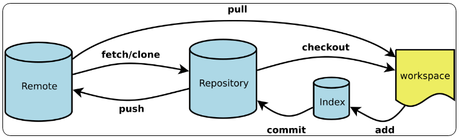

# Git使用

## 工作区说明



| 名称            | 说明                                                        |
| ------------- | --------------------------------------------------------- |
| Workspace     | 工作区，就是你平时存放项目代码的地方。                                       |
| Index / Stage | 暂存区，用于临时存放你的改动，事实上它只是一个文件，保存即将提交到文件列表信息。                  |
| Repository    | 仓库区（或版本库），就是安全存放数据的位置，这里面有你提交到所有版本的数据。其中 HEAD 指向最新放入仓库的版本 |
| Remote        | 远程仓库                                                      |

## 参数说明

### 一、分支说明

| 名称    | 说明                |
| ------- | ------------------- |
| origin  | 源,远程服务器，默认 |
| main    | 主分支              |
| hotfix  | 修补bug             |
| release | 发放版本            |
| develop | 开发版本            |
| feature | 功能版本            |

### 二、回滚参数说明

| 状态 | 说明              |
| ---- | ----------------- |
| HEAD | 最新版本          |
| ~    | 上一个版本        |
| ~n   | 上n个版本         |
| ^    | 步数，一个^，一步 |

### 三、常用命令

`git fetch origin`：**只看不拿**（只下载信息，不合并）

- `git fetch 远程名 分支名`  

- 使用场景

  - 你想**先看看**别人提交了啥，再决定要不要合并
  - 你想对比远程和本地的差异：`git diff origin/main`
  - 你的本地有未提交的改动，不想冒险触发冲突
  - 你在写自动化脚本，只想同步信息暂不操作

- `git fetch` 与`git fetch origin`区别

  只有1个仓库效果相同，若有多个仓库，会从默认仓库拉取信息（通常为origin）

`git pull / git pull origin main`：**下载 + 合并**（fetch + merge 的组合拳）

- 执行了2步，`git fetch origin`与`git merge origin/main` 
- 此代码会直接更新本地**没有冲突**的代码，如果有冲突，会报错
- 执行场景
  - 你确定本地代码是干净的（已提交或暂存）
  - 你想快速把队友的最新代码同步到本地继续开发
  - 你懒得敲两条命令

`git add .`：不包括删除文件

`git add *`：修改、删除、新建都添加（可能会把不需要的文件添加进来）

### 四、忽略文件

1. 使用方法：在根目录下创建文件`.gitignore`

``` shell
# 忽略所有 .log 文件
*.log

# 忽略特定文件
debug.ini
# 忽略 /build 目录
build/

# 忽略 /logs 目录下的所有内容
logs/*

# 忽略所有 .txt 文件，但不忽略 important.txt
*.txt
!important.txt

# 这是注释，不会影响 Git 行为
*.bak
```

- 忽略当前，不能使用`.`

```shell
git rm -r --cached .
git add .
git commit -m "update .gitignore"  # windows使用的命令时，需要使用双引号
```

## 核心操作

### 一、检查状态

``` python
git fetch origin # 获取远端数据
git status # 检查状态
```

输出信息说明

1. `nothing to commit, working tree clean`：工作区干净，没有改动，可以拉取或推送
2. `modified: xxx`：有文件被修改了，但还没暂存，决定是否提交
3. `Changes to be committed`：文件已暂存，等待提交，`git commit` 提交
4. `Untracked files`：有新文件，Git还没追踪。`git add` 添加追踪
5. `Your branch is ahead of origin/main by X commits`：本地领先远程X个提交，需要 `git push`
6. `Your branch is behind origin/main by X commits` ：本地落后远程X个提交，需要 `git pull`
7. `Your branch and origin/main have diverged` ：本地和远程都有各自的新提交，需要先 `git pull` 合并

### 二、上传代码

#### Ⅰ、本地领先远程，且无冲突

- **判断**：`git status` 显示 `Your branch is ahead of origin/main by X commits`

```bash
git push origin main
```

#### Ⅱ、首次推送（本地关联远程空仓库）

**条件**：远程仓库是空的，没有 README 等文件

```bash
git init
git remote add origin 地址
git add .
git commit -m "xxx"

git push -u origin main
# 将本地master推送到远端main分支
git push -u origin master:main 
```

**条件**：远端仓库有readme文件

- `--allow-unrelated-histories`：仅在首次合并两个独立仓库时需要，后续操作不再需要。

- `--set-upstream origin master`：把本地的分支推送到远程的 `master` 分支，并建立追踪关系。

  当前代码可缩写为：`-u`

- 当没有使用`--allow-unrelated-histories`，可以尝试在`git push`中使用`--set-upstream origin main` 

- 如果连接了错误的分支：

  修改本地分支master连接远端main分支

  `git branch --set-upstream-to=origin/main master`

``` bash
git init
# 检查分支名称，如果与远端不同，就修分支名称
git status 
git branch -m master main

git remote add origin 远端地址
# 如果忘记输入git pull...，需要重新从这里开始
git pull origin main --allow-unrelated-histories
git add .
git commit -m "xxx"
git push -u origin main
```

#### Ⅲ、远程有新提交

- **判断**：`git push` 报错 `! [rejected] main -> main (fetch first)`
- **原因**：在你上次拉取之后，远程有别人提交了新代码。

**解决步骤**：

```bash
# 1. 先拉取远程代码
git pull origin main

# 2. 如果有冲突，解决冲突（）

# 3. 再次推送
git push origin main
```

#### Ⅳ、强制推送

- **判断**：你确定要用本地代码完全覆盖远程代码，丢弃远程的所有提交
- **危险**：会覆盖远程提交，导致其他人的工作丢失。**只在个人分支或确认无人在用时使用。**

```bash
git push --force origin main
```

或更安全的版本：

```bash
git push --force-with-lease origin main
```

#### Ⅴ、推送特定分支

```bash
# 推送当前分支到远程同名分支
git push origin HEAD

# 推送本地分支到远程指定分支
git push origin 本地分支名:远程分支名

# 例如：推送本地 feature 分支到远程 feature-login
git push origin feature:feature-login
```

#### Ⅵ、删除远程分支

```bash
git push origin --delete 分支名
```

#### Ⅶ、上传本地到已有库

```bash
# 初始化 Git 仓库
git init
# 添加远程仓库地址（替换成你自己的）
git remote add origin 库地址
# 验证是否关联成功
git remote -v
# 应该显示 origin 的 fetch 和 push 地址
```

### 三、下载代码

#### Ⅰ、本地没有任何修改

- **判断**：`git status` 显示 `nothing to commit, working tree clean`
- 包括：本地文件是空的 、本地文件未修改、本地修改不想要了（可以看强制更新本地）
- 注意：如果你的默认分支是 `master`，把上面的 `main` 换成 `master`。

``` python
# github与本地是同一个库
git pull origin main
```

强制更新本地

``` shell
# 丢弃本地所有未提交的修改
git reset --hard HEAD
git pull origin main

# 回到远程最新状态
git fetch origin
git reset --hard origin/main
```

第一次关联远程仓库（本地和远程没有共同历史）

- **判断**：本地用 `git init` 创建，远程仓库有 README 等文件

```bash
git pull origin main --allow-unrelated-histories
```

#### Ⅱ、保留本地并同步远程

- **判断**：`git status` 显示 `modified: xxx`

方式A：先提交再拉取（推荐）

```bash
git add .
git commit -m "保存当前进度"
git pull origin main
# 如果有冲突，解决冲突（见下方【冲突处理】）
```

方式B：先暂存再拉取（不想提交）

```bash
git stash                    # 暂存当前修改
git pull origin main         # 拉取远程代码
git stash pop                # 恢复之前的修改
# 如果有冲突，解决冲突
```

#### Ⅲ、丢弃本地修改

- **判断**：确定本地修改不要了，想完全变成远程的样子

```bash
git fetch origin
git reset --hard origin/main
```

### 四、本地与远程有冲突

#### Ⅰ、冲突发生时的提示

执行 `git pull` 或 `git merge` 时，会看到：

```python
Auto-merging index.html
CONFLICT (content): Merge conflict in index.html
Automatic merge failed; fix conflicts and then commit the result.
```

或者用 `git status` 查看：

```python
On branch main
You have unmerged paths.
  (fix conflicts and run "git commit")
  (use "git merge --abort" to abort the merge)

Unmerged paths:
  (use "git add <file>..." to mark resolution)
	both modified:   index.html
```

**关键信息**：

- 冲突文件是 `index.html`
- 状态是 `both modified`（双方都修改了）

#### Ⅱ、解决冲突的标准流程

第1步：找到冲突文件，列出冲突文件：`git status` 

第2步：打开冲突文件，看标记

- `<<<<<<< HEAD` 到 `=======`：**你本地的修改**
- `=======` 到 `>>>>>>>`：**远程/别的分支的修改**
- 你需要决定保留哪个，或组合成新的

```html
<!-- 冲突文件里会有这样的标记 -->

<<<<<<< HEAD
你的代码：我改成了红色
=======
远程代码：同事改成了蓝色
>>>>>>> 提交哈希
```

第3步：手动编辑，决定最终内容

**选择A：保留你的版本**：删掉所有标记和同事的版本。

**选择B：保留同事的版本**：删掉所有标记和你的版本。

**选择C：合并两个人的修改**：重新组合成你想要的内容。

**重要**：删除所有 `<<<<<<<`、`=======`、`>>>>>>>` 标记，否则Git不认。

第4步：标记冲突已解决

```python
git add index.html
# 或者添加所有冲突文件
git add .
```

第5步：提交合并结果

```python
git commit -m "解决index.html冲突，采用红色方案"
# 或直接
git commit  # 会生成默认的合并提交信息
```

### 五、工作流程

``` bash
# ========== 上午开始工作 ==========
# 1. 检查状态
git status

# 2. 同步远程最新代码（假设本地干净）
git pull origin main

# 3. 开始写代码...

# ========== 下午工作结束 ==========
# 4. 检查改了哪些
git status
git diff

# 5. 添加并提交
git add .
git commit -m "今天完成的工作内容"

# 6. 拉取远程最新（防止有人先提交了）
git pull origin main

# 7. 如果有冲突，解决冲突...
#    （编辑冲突文件 → git add → git commit）

# 8. 推送
git push origin main

# 9. 确认推送成功
git status
# 显示：nothing to commit, working tree clean
```

### 六、开发新功能

标准流程

1. 从主分支拉取最新代码
2. 创建功能分支
3. 在分支上开发、提交
4. 推送到远程（备份）
5. 合并回主分支
6. 删除功能分支

#### Ⅰ、同步主分支最新代码

```bash
# 切换到主分支
git checkout main

# 拉取最新代码
git pull origin main

# 确认状态
git status
# 显示：Your branch is up to date with 'origin/main'
```

#### Ⅱ、创建并切换到功能分支

- **目的**：隔离开发环境，不影响主分支。
- **分支命名规范**：
  - `feature-xxx`：新功能
  - `bugfix-xxx`：修复bug
  - `hotfix-xxx`：紧急修复
  - `release-xxx`：发布准备

```bash
# 方式A：创建并切换（最常用）
git checkout -b feature-你功能的名字

# 方式B：分两步做
git branch feature-你功能的名字
git checkout feature-你功能的名字

# 查看当前分支（确认已在功能分支）
git branch
# * feature-login  ← 星号表示当前分支
#   main
```

#### Ⅲ、开发功能（循环操作）

- **提交信息规范**（推荐）：

  `feat`: 新增功能
  `fix`: 修复bug
  `docs`: 文档更新
  `style`: 代码格式调整
  `refactor`: 重构代码
  `test`: 测试相关
  `chore`: 构建/工具变动

```bash
# 写代码...

# 查看改了什么
git status
git diff

# 阶段性提交（建议频繁提交）
git add .
git commit -m "feat: 完成登录界面UI"
```

#### Ⅳ、推送到远程（备份）

- **目的**：把代码备份到GitHub，防止本地丢失，也方便团队查看。

```bash
# 首次推送该分支
git push -u origin feature-login

# 之后再次推送
git push origin feature-login
# 或简写（已建立关联后）
git push
```

**查看远程分支是否成功**：

```bash
git branch -r
# origin/main
# origin/feature-login  ← 出现了
```

#### Ⅴ、合并回主分支

- **目的**：功能开发完成，测试通过后，合并到主分支。

方式A：标准流程（推荐）

```bash
# 1. 切换到主分支
git checkout main

# 2. 拉取最新代码（防止有人先合并了）
git pull origin main

# 3. 合并功能分支
git merge feature-login

# 4. 如果有冲突，解决冲突
#    （编辑冲突文件 → git add → git commit）

# 5. 推送到远程
git push origin main
```

方式B：先rebase再合并（保持历史整洁）

```bash
# 1. 在功能分支上，变基到最新main
git checkout feature-login
git rebase main
# 如果有冲突，解决后 git rebase --continue

# 2. 切换到main
git checkout main

# 3. 合并（此时是fast-forward，不会产生合并提交）
git merge feature-login

# 4. 推送
git push origin main
```

#### Ⅵ、清理分支

- **目的**：删除已合并的功能分支，保持仓库整洁。

```bash
# 删除本地分支
git branch -d feature-login

# 删除远程分支（可选）
git push origin --delete feature-login

# 查看剩余分支
git branch
# * main  ← 只有主分支了
```

### 七、其他情况

#### Ⅰ、功能开发到一半，需要切回去修bug

```bash
# 当前在 feature-login 分支，工作区有未提交的修改

# 方式A：提交当前进度（推荐）
git add .
git commit -m "WIP: 登录功能开发中（未完成）"
git checkout main
git checkout -b hotfix-urgent-bug
# 修bug...
git add .
git commit -m "fix: 修复紧急bug"
git checkout main
git merge hotfix-urgent-bug
git push origin main
# 切回功能分支继续开发
git checkout feature-login

# 方式B：暂存修改
git stash
git checkout main
git checkout -b hotfix-urgent-bug
# 修bug...
git stash pop  # 回到功能分支后恢复
```

#### Ⅲ、多人协作同一个功能分支

```bash
# 同事A推送了更新
# 同事B需要拉取

git checkout feature-login
git pull origin feature-login
# 如果有冲突，解决冲突

# 继续开发...
git add .
git commit -m "feat: 完善登录验证"
git push origin feature-login
```

## 常用功能

### 一、查看历史记录

- **场景**：线上出bug了，想知道这行代码是谁写的、为什么这么写。

```python
# 查看谁在什么时候改了哪一行
git blame 文件名

# 查看某个文件的完整修改历史
git log --follow -p 文件名

# 查看某行代码是谁写的
git blame -L 10,20 文件名

# 查看文件内容的具体改动
git diff

# 查看具体哪些文件被改了
git diff --name-only

# 查看已暂存但未提交的改动
git diff --staged
```

### 二、回退到任意历史版本

- **场景**：新功能上线后发现重大问题，需要紧急回滚到稳定版本。

```python
# 回到某个历史提交（保留修改）
git reset --soft 提交哈希

# 回到某个历史提交（丢弃所有修改）
git reset --hard 提交哈希

# 回到某个历史提交（创建新提交来回退，不影响历史）
git revert 提交哈希
```

### 三、分支管理（branch）

- **场景**：同时开发多个功能、修复多个bug，互不干扰。

```python
# 创建新分支
git branch 分支名称

# 切换分支
git checkout 分支名称

# 创建并切换（快捷操作）
git checkout -b 分支名称

# 查看所有分支
git branch -a

# 删除分支
git branch -d 分支名称
```

###  四、代码审查（Code Review）

- **场景**：同事提交了代码，你想review他改了哪些内容再合并。

```python
# 查看某个提交的详细改动
git show 提交哈希

# 比较两个分支的差异
git diff main..feature-login

# 查看即将提交的改动
git diff --staged
```

### 五、合并分支

- **场景**：功能开发完成，选择用merge还是rebase合入主分支。

```python
# 普通合并
git merge 分支名称
# 假设当前在main分支，经A分支合并到main
git merge A

# 只合并某个提交
git cherry-pick 提交哈希

# 使用工具解决冲突，mergetool是合并工具
git mergetool
```

变基合并

- `git rebase 分支名称`：把当前分支的提交，重新"嫁接"到另一个分支的最新提交上。

``` python
# 1. 从主分支创建功能分支
git checkout main
git pull origin main  # 确保本地 main 最新
git checkout -b feature-login

# 2. 开发功能，多次提交
git add .
git commit -m "添加登录UI"

# 3. 开发完成，准备合并（先拉取最新 main）
git checkout main
git pull origin main  # 获取远程最新

# 4. 回到功能分支，rebase 到最新 main
git checkout feature-login
git rebase main

# 如果有冲突，逐个解决
# 解决冲突后：
git add .
git rebase --continue

# 5. 整理提交历史（可选）
git rebase -i HEAD~3
# 将3个提交合并成1个：pick, squash, squash

# 6. 合并到主分支（快进合并）
git checkout main
git merge feature-login  # 此时是 fast-forward

# 7. 推送到远程
git push origin main
```

### 六、本地分支名与远端不同

#### Ⅰ、远端有同名但名字不同

- **场景**：本地 `master`，远端 `main`。远端有同名但名字不同（最常见的场景）

```bash
# 查看当前状态
git branch -vv
# * master abc1234 [origin/main: ahead 1] 你的提交
```

**解决方案（推荐）**：把本地分支重命名为和远端一致。

```bash
# 1. 重命名本地分支
git branch -m master main

# 2. 设置追踪关系
git branch -u origin/main

# 3.更新本地数据
git pull origin main

# 4.推送（现在直接 push）
git push origin main
```

#### Ⅱ、远端没有对应的同名分支

- **场景**：本地 `feature-login`，远端没有 `feature-login`。

```bash
# 查看状态
git branch -vv
# * feature-login abc1234 [origin/???] 你的提交
```

**解决方案**：推送时建立追踪关系。

```bash
# 推送并建立追踪关系（远端会创建同名分支）
git push -u origin feature-login
```

#### Ⅲ、推送到指定的远端分支

- **场景**：本地 `develop`，想推送到远端 `main`。
- **注意**：这种方式虽然可行，但容易混淆，**不推荐**。除非有特殊需求（如长期维护旧命名规范）

```bash
# 查看状态
git branch -vv
# * develop abc1234 你的提交
```

**解决方案**：推送时指定远端分支名。

- **结果**：本地 `develop` 追踪远程 `origin/main`。以后 `git pull` 会从 `origin/main` 拉取，但本地分支名依然是 `develop`。

```bash
# 推送本地 develop 到远程 main
git push -u origin develop:main
```

### 七、暂存部分修改（精细控制）

- **场景**：一个文件里改了3个功能，但只想提交其中1个，另外2个下次再提交。

```python
# 交互式添加：可以选择只提交文件的某几行
git add -p 文件名

# 暂存当前工作，去处理紧急bug
git stash
git stash pop  # 回来后恢复

# 列出所有暂存
git stash list
```

### 八、修改历史提交（改写历史）

- **场景**：提交信息写错了、多个小提交想合并成一个完整的功能提交。

```
# 修改最近一次提交的说明
git commit --amend -m "新的提交信息"

# 修改最近3次提交（交互式）
git rebase -i HEAD~3

# 合并多次提交为一个
git rebase -i HEAD~5  # 然后选择 squash
```

### 九、标签管理（版本发布）

- **场景**：项目发布v1.0、v2.0版本，方便后续追溯。

```python
# 创建轻量标签
git tag v1.0.0

# 创建附注标签（带说明）
git tag -a v1.0.0 -m "正式发布版本"

# 推送标签到远程
git push origin --tags

# 查看所有标签
git tag
```

### 十、工作流管理

- **场景**：了解当前项目整体状态，规划下一步工作。

```python
# 查看当前状态
git status

# 查看简洁状态
git status -s

# 查看提交图
git log --graph --oneline --all
```

### 十一、子模块管理（多仓库依赖）

- **场景**：项目依赖第三方库，需要版本锁定。

```
# 添加子模块
git submodule add https://github.com/xxx/library.git

# 更新所有子模块
git submodule update --init --recursive
```

### 十二、找回丢失的提交

- **场景**：不小心用 `git reset --hard` 删除了还没推送的代码，可以用这个救回来。

```
# 查看所有操作记录（包括已删除的提交）
git reflog

# 基于reflog恢复
git checkout HEAD@{2}
```

### 十三、清理未追踪文件

- **场景**：项目里有很多临时文件、编译产物，想一键清理。

```bash
# 查看哪些文件会被删除
git clean -n

# 删除未追踪的文件
git clean -f

# 删除未追踪的文件和目录
git clean -fd
```

让Git忘记文件，但保留本地文件

- `git rm -r --cached 文件或文件夹名` 

  `--cached`：只从 Git 的"追踪列表"里删除，**不删除本地硬盘上的实际文件**。

  `-r`：递归删除文件夹。

### 十四、二分查找bug（git bisect）

- **场景**：项目有1000次提交，不知道从哪个版本开始出现bug，用这个自动查找。

```
# 开始二分查找
git bisect start

# 标记当前版本有bug
git bisect bad

# 标记某个旧版本没有bug
git bisect good 提交哈希

# Git会自动切换版本让你测试，直到找出引入bug的提交
```

### 十五、查看代码变动统计

- **场景**：周报要写"本周新增代码量"。

```
# 查看每个作者的提交统计
git shortlog -sn

# 查看代码行数统计
git ls-files | xargs wc -l

# 查看某段时间的改动
git log --since="2026-01-01" --until="2026-07-19"
```

## 使用SSH Key

1. 生成ssk公钥

    `ssh-keygen -t rsa -C "添加注释，一般为邮箱" -f "指定用来保存密钥的文件名"`

2. 确定密钥保存位置

    ```shell
    Enter file in which to save the key
    (/Users/your_user_directory/.ssh/id_rsa): 按回车键
    ```

3. 输入密码密码

    ``` shell
    Enter same passphrase again: 再次输入密码
    shellEnter passphrase (empty for no passphrase): 输入密码(一般不输入密码，直接回车)
    ```

4. 查看公钥内容

    ``` shell
    # LINUX
    cat ~/.ssh/id_rsa.pub
    
    # WINDOWS
    # 直接使用记事本打开
    ```

5. 测试GIT是否成功

    ``` shell
    # github
    ssh -T git@github.com
    # 返回
    Hi WillOfTree! You've successfully authenticated, but GitHub does not provide shell access.
    ```

6. github修改配置文件

    ```shell
    # 位置：.git 文件夹下 config 中的url
    [remote "origin"]
    url = https://github.com/humingx/humingx.github.io.git
    fetch = +refs/heads/*:refs/remotes/origin/*
    # 将https地址修改为ssh的地址
    [remote "origin"]
    url = git@github.com:humingx/humingx.github.io.git
    fetch = +refs/heads/*:refs/remotes/origin/*
    ```

## 错误信息

### 1、SECURITY WARNING

```shell
warning: ----------------- SECURITY WARNING ----------------
warning: | TLS certificate verification has been disabled! |
warning: ---------------------------------------------------
warning: HTTPS connections may not be secure. See https://aka.ms/gcm/tlsverify for more information.
```

解决方法：

```shell
git config --global http.sslVerify true
```

### 2、中文乱码

```shell
git config --global core.quotepath false
```

### 3、443错误

```shell
fatal: unable to access 'https://github.com/WillOfTree/whiteZe.git/': Failed to connect to github.com port 443 after 21133 ms: Timed out
```

解决方法一：使用代理服务

解决方法二：取消代理服务

```shell
git config --global --unset http.proxy
git config --global --unset https.proxy
```

> error: src refspec main does not match any
> error: failed to push some refs to 'github.com:WillOfTree/DiJiang.git'

- 远程库与本地库名称不相同导致，更改名称

  `git branch -m oldBranchName newBranchName`

> error: failed to push some refs to 'github.com:WillOfTree/DiJiang.git'

- `git pull origin <branch-name>` ：拉取远程长裤的最新更改
- `git push -f origin <branch-name>` ：强制用本地分支覆盖远程分支
